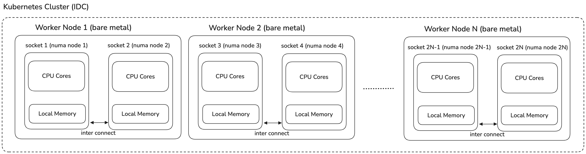
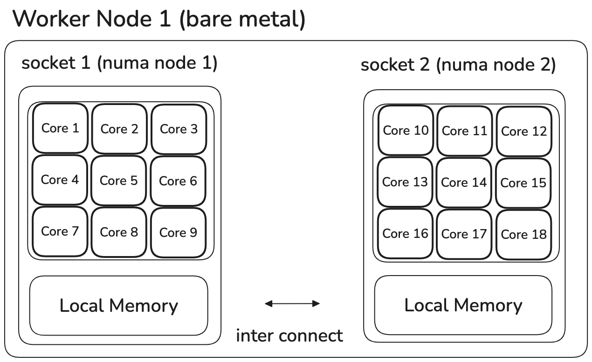
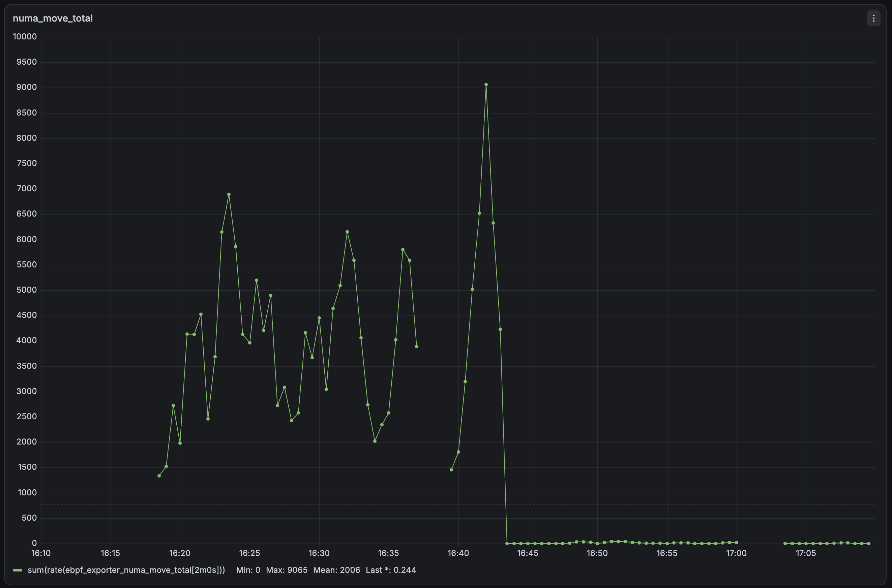
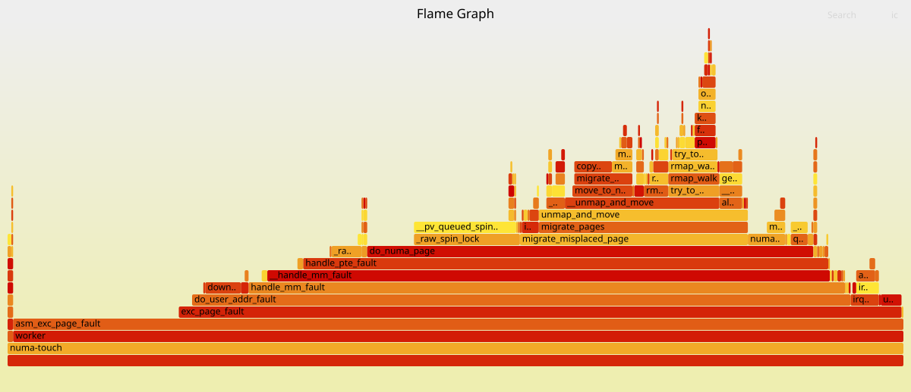
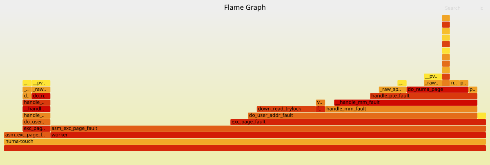

## 실험 개요

토스의 사례의 문제를 한줄로 정리하면 다음과 같이 작성할 수 있을 것 같습니다.

> CPU 사용률 중 가장 많은 부분을 차지하는 page fault에서 `do_numa_page` 동작 중 `migrate_misplaced_page` 수행 시간이 전체의 50% 이상을 차지한다

`migrate_misplaced_page`란 NUMA 아키텍처 시스템에서 동작하는 Auto NUMA Balancing에 의해 Remote Access가 발생하는 페이지를 Local Access 할 수 있도록 현재 프로세스가 동작하는 코어와 가까운 위치로 페이지를 이동시키는 것입니다.

이렇게 한번 이동한 페이지를 코어에서 계속 쓴다면 아무 문제 없겠지만, 동작하는 코어가 움직인다면 계속 Remote Access가 발생할 수 밖에 없고, 위 사례처럼 `migrate_misplaced_page`가 많이 발생하게 되는 것입니다.

## 토스 인프라 구성

토스 인프라 구성은 위와 같이 IDC 안에 Bare metal 서버들로 구성된 쿠버네티스 클러스터 형태에 가까울 것입니다. 정확한 개수까지는 알 수 없지만, 각 Bare metal 서버안에 2개의 소켓이 있다고 가정해보겠습니다.

각 소켓에는 CPU 코어들과 Memroy가 있을 것이고, 서버에서 설치된 kubelet에 의해 Pod가 어떤 소켓의 어떤 CPU와 Memory를 배정받느냐가 결정됩니다.

위 사례에서는 이 지점에서 바로 문제가 발생했습니다. Pod가 1번 소켓의 코어를 사용중인데, 2번 소켓의 메모리에 있는 페이지에 접근하여 1번 소켓의 메모리로 `migrate_misplaced_page`가 발생했습니다. 그것도 `do_numa_page` 동작 중 50% 이상을 차지할 정도로 말이죠.

왜 이런 일이 발생할까요?

## 쿠버네티스에서 리소스(CPU, Memory) 할당 방법

쿠버네티스에 애플리케이션 파드를 배포한다는 것은 크게 2가지 과정을 거쳐 진행됩니다.

1. apiserver로 파드 요청서(필요한 cpu, memory 크기 등) 전달
2. kubelet이 파드 요청서에 맞게 커널에 컨테이너 생성 요청

kubelet이 컨테이너 생성 요청을 할 때 파드 요청서에 적힌 request 만큼 CPU, Memory를 설정하게 되는데,
이때 하나의 Worker Node에서 어떤 코어, 메모리 조합으로 묶을 지는 kubelet의 CPU Manager/ Memory Manager 각 정책에 따라 결정됩니다.

CPU Manager, Memory Manager에는 각각 None Policy, Static Policy 2개의 정책이 있습니다.

먼저 CPU Manager 부터 살펴보겠습니다. 

기본 정책인 None Policy는 서버의 소켓 및 NUMA 아키텍처 고려 없이 배치됩니다. Cgroup을 통해 자원이 컨테이너 단위로 할당되는데요, None Policy에서는 어떤 코어를 사용해야한다는 제한도 하지 않기 때문에 cpuset.cpu 값이 설정되지 않게 되고, 이 값이 비어있으면 부모 그룹의 cpuset.cpus.effective 값을 상속받습니다.
즉, None Policy에서는 어떤 코어에서 도는 지 제한 없이 하나의 쿠버네티스 노드 안에서 모든 코어를 사용할 수 있게 됩니다.

Static Policy는 고정된 크기의 자원을 보장할 수 있도록 배치됩니다. 그렇기 때문에 CPU 코어 요청이 정수여야 하고, QoS가 Gauranteed(request == limit) 여야 합니다. Static Policy에서 들어오는 CPU 코어 요청은 cpuset.cpu 값이 설정됩니다.

정리하면 CPU 요청은 아래와 같이 정리 됩니다. (cgroup v2 기준)

- 어떤 코어에서 돌릴 지: cpuset.cpus
- 경합 발생 시 몫: cpu.weight (단위 없는 상대값, 비율을 위한 숫자)
- 경합과 상관 없이 최대 상한: cpu.max (마이크로초(µs) 단위의 시간)

따라서 Static Policy에서는 Topology Manager 정책 등을 통해 결정된 CPU 코어로 사용이 고정됩니다.

Memory Manager도 유사합니다.

None Policy에서는 cpuset.mems 값이 설정되지 않아 Cgroup 상속으로 노드의 모든 NUMA에서 메모리를 할당받습니다. 커널이 알아서 고르니 보통 "프로세스가 도는 CPU와 가까운 NUMA" 정책을 따르지만, 보장은 없습니다.

Static Policy에서는 Guaranteed 파드에 한해 NUMA를 정해서 cpuset.mems에 기록합니다. 그러면 그 컨테이너는 지정된 NUMA에서만 메모리를 받습니다.

## 문제 이해하기

문제 상황을 아래와 같이 요약할 수 있습니다.

> 쿠버네티스 기본 정책에서 컨테이너의 스레드는 노드의 모든 코어와 메모리를 사용할 수 있다. 커널 스케줄러는 부하에 따라 스레드를 다른 코어로 옮기고, 그 코어가 다른 NUMA 노드에 속하면 기존에 할당된 메모리는 원격 접근이 된다. 커널의 Auto NUMA Balancing은 이를 감지해 페이지를 옮기지만(migrate_misplaced_page), 이 과정 자체가 추가 비용이다.

JVM 기반 애플리케이션을 예로 들면, 리눅스의 First-Touch 정책은 JVM 힙에도 그대로 적용됩니다. 힙 영역은 기동 시 가상 주소 공간으로 예약될 뿐이고, 실제 물리 페이지는 그 영역을 처음 건드린 스레드가 속한 NUMA 노드에 배치됩니다.

따라서 힙의 물리적 분포는 "누가 언제 먼저 터치했는가"에 달려있습니다. -XX:+AlwaysPreTouch로 기동 시 힙 전체를 미리 터치하면 그 시점의 스레드 위치에 몰리고, 기본값에서는 런타임에 여러 워커 스레드가 할당하면서 여러 NUMA에 흩어지게 됩니다.

어느 경우든 힙의 물리적 위치와 그 힙을 읽는 스레드의 위치가 일치한다는 보장이 없고, 특히 힙 전체를 훑는 GC는 원격 접근을 피하기 어렵습니다. [^1]

[^1]: https://kjhoon0330.tistory.com/entry/NUMA와-JVM과-k8s

## 실험 설계

### 배경

토스 사례에서는 CPU 사용률의 상당 부분을 page fault가 차지했고, 그중 `do_numa_page` 처리 과정에서 `migrate_misplaced_page`가 절반가량을 점유했습니다.

### 원인 추정

쿠버네티스의 기본 정책(None)에서는 컨테이너의 스레드가 노드의 모든 코어를 사용할 수 있고, 커널 스케줄러가 부하 분산 과정에서 다른 NUMA 노드의 코어로 옮깁니다. 이때 기존에 할당된 메모리는 원격 접근이 되고, Auto NUMA Balancing이 이를 감지해 페이지 마이그레이션을 수행합니다.

### 기존 방안의 한계

Static Policy를 쓰면 CPU와 메모리를 NUMA에 고정할 수 있지만, 대상이 Guaranteed QoS 파드로 제한됩니다. CPU request가 정수여야 한다는 제약도 있어, Burstable 파드가 다수인 환경에서는 적용 범위가 좁습니다.

### 가설

파드 단위로 CPU와 메모리를 같은 NUMA 노드에 배치하는 커스텀 정책(NumaShared)을 적용하면, Burstable 파드를 포함한 전체 워크로드에서 원격 메모리 접근과 그에 따른 페이지 마이그레이션이 감소할 것입니다.

이 가설은 세 부분으로 나누어 검증했습니다. 첫째, 원격 접근과 마이그레이션이 감소합니다. 둘째, CPU와 메모리가 같은 NUMA 노드를 가리킵니다. 셋째, Burstable 파드를 포함한 전체 워크로드에 적용됩니다. 각 부분의 판정은 실험 결과의 가설 검증에 정리했습니다.

### 검증 지표

- `/proc/vmstat`의 `numa_hint_faults`, `numa_hint_faults_local`(remote 비율 산출), `numa_pages_migrated`, `numa_pte_updates`(스캐너 활성 여부)
- `numastat -p <pid>`의 노드별 메모리 분포(Private, MB)
- 컨테이너의 `cpuset.cpus.effective`, `cpuset.mems.effective`가 같은 NUMA를 가리키는지
- page fault 플레임그래프에서 `do_numa_page`, `migrate_misplaced_page`가 차지하는 비중

### 시나리오

단일 워커 노드(`k8s-worker1-001`)에서 같은 파드 구성을 두고 kubelet 정책만 바꿔 두 번 측정했습니다. 조건마다 절차는 같습니다.

1. kubelet 정책을 적용합니다. 설정을 교체하고 정책 state 파일을 삭제한 뒤 kubelet을 재시작합니다.
2. 파드를 전부 삭제하고 측정 대상과 경합 파드를 다시 배포합니다.
3. 배치 증거를 수집합니다. cpuset과 mems, `cpu.max`, state 파일, 스레드별 실행 CPU, 메모리 노드 분포를 기록합니다.
4. 5분간 워밍업합니다. AutoNUMA 스캐너가 정상 상태에 들어가기를 기다리기 위해서입니다.
5. vmstat 구간 측정을 120초씩 3회 합니다. 회차 사이에 60초를 두고 numastat을 함께 기록합니다.
6. ebpf-exporter를 중지하고 page fault 플레임그래프를 120초간 캡처한 뒤 exporter를 다시 켭니다.

경합 파드를 함께 둔 이유는 다음과 같습니다. 워킹셋이 NUMA 노드 하나에 들어가고 CPU가 한가하면 기본 스케줄링만으로도 배치가 이미 좋아져 정책이 개선할 여지가 없습니다(초기 실측에서 remote가 거의 없었습니다). 토스의 문제는 노드에 파드가 많고 CPU 압력이 있어 스케줄러가 스레드를 계속 옮기는 상황에서 발생하므로, 경합 파드로 그 압력을 만들었습니다.

측정 전에 판정 기준을 미리 정했습니다. policy의 remote는 2% 미만, migration은 100/s 미만이어야 하고, 메모리가 한 노드에 집중되어야 하며, `numa_pte_updates`가 0이 아니어야 합니다.

### 비교 대상

| 구분 | CPU Manager | Memory Manager | Topology Manager | 비고 |
|---|---|---|---|---|
| A. baseline | `none` | `None` | 기본 | 대조군 |
| B. NumaShared | `numa-shared`(커스텀) | `NumaShared`(커스텀) | `best-effort`, `pod` 스코프 | 실험군 |

두 조건은 같은 날 같은 부팅 세션에서 측정했습니다. kubelet 바이너리(크기 150,984,737 bytes, sha256 `eb8969aae6c3af13`), 파드 스펙, `cpu.max`, `cpu.weight`는 동일하게 유지했습니다.

정책 B는 다음과 같이 동작합니다. CPU는 파드에 배타 코어를 주지 않고 한 NUMA 노드의 CPU 범위 전체를 cpuset으로 배정합니다. 버스트 여력은 그대로 유지되고, QoS 제한은 두지 않으며(BestEffort 제외) 소수점 요청은 올림합니다. 노드는 부하(`numaLoad`)와 용량으로 고릅니다. 메모리는 파드의 메모리를 한 NUMA 노드에 고정하고(`cpuset.mems`), 어느 노드에도 들어가지 않으면 고정하지 않고 폴백합니다. 메모리 정책은 pod 스코프에서만 힌트를 내므로 `topologyManagerScope: pod`가 필요합니다. container 스코프에서는 CPU와 메모리가 서로 다른 노드로 갈 수 있습니다.

### 워크로드 구성

환경은 다음과 같습니다.

| 항목 | 값 |
|---|---|
| 호스트 | i7-10700 (싱글 소켓, 물리 NUMA 노드 1개) |
| 측정 노드 | `k8s-worker1-001` (VM, 6 vCPU, QEMU/libvirt vNUMA 2개) |
| vNUMA 토폴로지 | node0: CPU 0-2, 2,910MB / node1: CPU 3-5, 3,022MB |
| 소프트웨어 | Ubuntu 22.04, 커널 5.15.0-198, Kubernetes v1.30.14, containerd 2.2.1 |
| 설정 | `numa_balancing=1`(기본), systemReserved와 kubeReserved 각 cpu 500m·mem 500Mi, reservedMemory 노드당 550Mi |

측정 대상은 `numa-baseline`(`numa-touch`)입니다.

| 항목 | 값 |
|---|---|
| 동작 | 스레드 3개가 1600MB 버퍼 하나를 공유하며 페이지마다 1바이트씩 증가시키는 순회를 무한 반복 |
| 메모리 | `MAP_PRIVATE \| MAP_ANONYMOUS \| MAP_POPULATE` (AutoNUMA 대상, 신규 할당 폴트 제거) |
| affinity | 워크로드가 스스로 조작하지 않음 (배치는 kubelet과 스케줄러가 결정) |
| QoS와 자원 | Guaranteed, `cpu: 2`, `memory: 2000Mi` (`cpu.max` = `200000 100000`) |
| 배포 | worker1에서 정적 빌드한 바이너리를 hostPath로 마운트 (`busybox:1.36` 이미지 사용) |

경합 파드는 `noisy-neighbor`입니다.

| 항목 | 값 |
|---|---|
| 동작 | `stress-ng --cpu 6` (CPU만 사용. `--vm`은 공유 매핑 문제가 있어 쓰지 않음) |
| QoS와 자원 | Burstable, request cpu 1·mem 256Mi, limit cpu 6·mem 512Mi |

스레드 수를 CPU 요청(2)보다 많은 3개로 둔 이유는, 정책이 없을 때 6개 코어 전체에 흩어지고 정책이 있을 때 한 노드에 갇히는 대비를 선명하게 하기 위해서입니다. 워크로드의 크기는 NUMA 노드 하나(CPU 3개, 약 2.9GB)에 들어가게 잡아 모든 정책을 같은 스펙으로 비교할 수 있게 했습니다. 버퍼를 스레드가 공유하게 한 이유도 있습니다. 프로세스마다 버퍼를 따로 두면 커널이 스스로 노드를 나누어 배치해 개선 여지가 없었고(실측 remote 13%), `stress-ng --vm`은 버퍼가 `MAP_SHARED`라 마이그레이션이 억제되었습니다.

### 측정 지표

| 지표 | 산출 방법 | 용도 |
|---|---|---|
| remote 비율 | 120초 전후 `/proc/vmstat` 차분. `(Δnuma_hint_faults − Δnuma_hint_faults_local) ÷ Δnuma_hint_faults` | 원격 접근의 정량 지표. 토스의 local 6000 : remote 4000과 같은 종류이며, 노드 전체 카운터라 다른 프로세스가 섞입니다 |
| migration 속도 | `Δnuma_pages_migrated ÷ 120초` | 페이지 마이그레이션 양 |
| hint fault 속도 | `Δnuma_hint_faults ÷ 120초` | AutoNUMA 스캔·처리 양 |
| `numa_pte_updates` | 구간 차분 | 스캐너가 활발했는지 확인 (0이면 hint fault가 잔재라 해석할 수 없음) |
| 메모리 노드 분포 | `numastat -p <pid>`의 Private(MB), cgroup `memory.numa_stat` | 메모리가 어느 노드에 놓였는지 |
| 배치 증거 | `cpuset.cpus/mems`(와 `.effective`), `Cpus_allowed_list`, `Mems_allowed_list`, 스레드별 PSR, kubelet state 파일 | 정책이 의도대로 걸렸는지 |
| page fault 플레임그래프 | `perf record -F 99 -a -g --call-graph dwarf -e cycles` 120초, page fault 스택만 추출 | NUMA 처리 비용의 구조와 비중 |
| 정규화 비용 | `numa-touch` 자신의 전체 사이클 대비 page fault, NUMA, migration 포함 사이클 | 경합 파드의 사이클을 뺀 비교 |
| throttle | cgroup `cpu.stat`의 `nr_throttled ÷ nr_periods` | CPU 상한에 걸린 정도 (교란 변수 기록) |

플레임그래프는 cycles 기준으로 캡처했습니다. `-e page-faults`로 재면 폴트 횟수의 비중이 나와 migration의 비싼 비용이 반영되지 않기 때문입니다. 캡처 때는 `ebpf_exporter`의 kprobe 오버헤드가 비율을 크게 부풀리므로 반드시 중지했습니다. vmstat 지표는 커널 카운터라 exporter의 영향을 받지 않습니다.

## 실험 결과

### 요약

**page migration이 기존 대비 약 99.7% 감소했습니다.(3,506~5,146/s -> 12~18/s)**

### 정책 적용 확인

| 항목 | A. baseline | B. NumaShared |
|---|---|---|
| `cpuset.cpus` (effective) | 비어 있음 (`0-5`) | `3-5` |
| `cpuset.mems` (effective) | 비어 있음 (`0-1`) | `1` |
| `Cpus_allowed_list` / `Mems_allowed_list` | `0-5` / `0-1` | `3-5` / `1` |
| 스레드 PSR | 2, 4, 2, 5 (양쪽 노드에 분산) | 3, 5, 4, 3 (node1에만 위치) |
| 메모리 `anon` (node0 / node1) | 364MB / 1,236MB | 4KB / 1,600MB |
| kubelet state | `policyName: none` / `None` | `numaEntries`상 numa-touch가 node1(2000m), 메모리 state도 node1 |
| `cpu.max` / `cpu.weight` | `200000 100000` / 174 | 동일 |
| noisy-neighbor 배치 | 같은 6코어를 공유 | node0(`1-2`)로 분리 |

B에서는 CPU와 메모리가 같은 NUMA 노드(node1)를 가리키는 것을 확인했습니다.

### vmstat 구간 측정 (120초 × 3회)

| 조건 | 회차 | remote | migration | hint fault | `numa_pte_updates` | 메모리 (node0 / node1) |
|---|---|---|---|---|---|---|
| A. baseline | 1 | 35.8% | 4,472/s | 28,797/s | 3,356,283 | 464 / 1,137 MB |
| | 2 | 35.0% | 3,506/s | 22,977/s | 2,680,518 | 521 / 1,080 MB |
| | 3 | 41.4% | 5,146/s | 34,228/s | 3,995,117 | 1,127 / 474 MB |
| | 중앙값 | 35.8% | 4,472/s | | | |
| B. NumaShared | 1 | 0.3% | 15/s | 4,529/s | 540,676 | 0.00 / 1,600.86 MB |
| | 2 | 0.7% | 18/s | 4,628/s | 556,288 | 0.00 / 1,600.86 MB |
| | 3 | 0.5% | 12/s | 4,571/s | 548,726 | 0.00 / 1,600.86 MB |
| | 중앙값 | 0.5% | 15/s | | | |

| 지표 | A. baseline | B. NumaShared | 변화 |
|---|---|---|---|
| remote 비율 | 35.0~41.4% | 0.3~0.7% | 범위가 겹치지 않음 |
| migration | 3,506~5,146/s | 12~18/s | 약 99.7% 감소 |
| hint fault | 22,977~34,228/s | 4,529~4,628/s | 약 84% 감소 |

세 회차 모두 `numa_pte_updates`가 수십만에서 수백만이어서 스캐너가 활발한 구간에서 잰 유효한 값입니다. B에서 hint fault가 줄어든 것은 접근이 전부 local이면 AutoNUMA가 스캔 주기를 늘리기 때문입니다.

A에서는 회차마다 메모리의 다수 노드가 node1에서 node0으로 뒤집혔습니다(1,137MB에서 1,127MB로). 스레드가 양쪽 노드에서 같은 페이지를 접근해 페이지가 노드 사이를 오가는 현상이 나타난 것입니다. B에서는 세 회차 모두 분포가 같았습니다. 다만 노드별 분포의 시계열은 측정하지 않아 스냅샷 4개만 있습니다.

### page fault 플레임그래프

| 지표 | A. baseline | B. NumaShared |
|---|---|---|
| page fault 스택 / 샘플 | 128줄 / 70,743 | 20줄 / 51,855 |
| page fault 전체 사이클 | 21,588,553,942 | 2,287,487,501 (89.4% 감소) |
| 그 중 NUMA(`do_numa_page` 포함) | 10,886,899,302 | 382,515,602 (96.5% 감소) |
| NUMA 비중 | 50.4% | 16.7% |
| 캡처 구간 remote | 42.0% | 0.4% |
| 캡처 구간 migration | 723,782건 | 295건 (99.96% 감소) |

A의 비용 구성은 다음과 같습니다(page fault 전체 대비).

| 프레임 | 비중 | `do_numa_page` 내 비중 |
|---|---|---|
| `migrate_misplaced_page` | 25.7% | 약 51% |
| `try_to_migrate`(rmap walk) | 5.7% | |
| `copy_page` | 4.2% | |
| `ptep_clear_flush`(TLB flush) | 2.3% | |
| 스핀락(`_raw_spin_lock`) | 11.8% | 약 23% |
| `numa_migrate_prep` | 4.2% | 약 8% |

B의 그래프에는 `migrate_misplaced_page`, `migrate_pages`, `copy_page`, `try_to_migrate`, `rmap_walk`, `flush_tlb` 계열 프레임이 하나도 없습니다. 남은 `do_numa_page`(3.8억 사이클)의 약 46%는 스핀락, 즉 페이지 테이블 락 경합입니다. 남은 NUMA 비용은 페이지 이동이 아니라 local hint fault 처리와 락 경합입니다.

### 정규화한 비용

`numa-touch` 자신의 전체 사이클 대비 비중입니다. 경합 파드의 사이클은 뺐습니다.

| | A. baseline | B. NumaShared |
|---|---|---|
| numa-touch 전체 사이클 | 1.0976 × 10¹² | 1.0937 × 10¹² (0.4% 감소) |
| page fault | 2.0% | 0.2% |
| NUMA(`do_numa_page` 포함) | 1.0% | 약 0.035% |
| 그 중 `migrate_misplaced_page` 포함 | 0.5% | 0.0% |

워크로드의 CPU 사용이 `cpu.max`(2코어 분량)에 묶여 있어, 시간으로 환산하면 상한 기준으로 NUMA는 약 20ms/s, migration은 약 10ms/s입니다(2코어 × 1000ms × 비중으로 잡은 추정). 토스가 보고한 "numa migration에 1초당 10~50ms"와 같은 범위입니다.

### 가설 검증

| 가설의 내용 | 판정 | 근거 |
|---|---|---|
| 원격 접근과 마이그레이션이 감소한다 | 지지 | remote 35.0~41.4%에서 0.3~0.7%로, migration 약 99.7% 감소. 범위가 겹치지 않고 플레임그래프에서 migration 서브트리가 사라졌습니다 |
| CPU와 메모리가 같은 NUMA를 가리킨다 | 지지 | `cpuset.cpus.effective`는 `3-5`, `cpuset.mems.effective`는 `1`이고, 스레드 PSR이 전부 node1이며 메모리 1,600MB가 전량 node1에 있습니다 |
| Burstable을 포함한 전체 워크로드에 적용된다 | 부분 확인 | 아래 설명 참조 |

이번에 측정한 대상(`numa-baseline`)은 Guaranteed입니다. 정책이 Burstable에도 적용된다는 증거는 kubelet state뿐입니다. Burstable인 `noisy-neighbor`(cpu-burner)와 `kube-flannel`이 NUMA 범위 cpuset(`1-2`)과 메모리 블록을 배정받았습니다. 그러나 Burstable 워크로드의 remote와 migration은 측정하지 않았으므로, 성능 측면에서는 확인하지 못했습니다.

## 결론

1. 정책의 효과인 원격 접근과 마이그레이션의 감소는 일관되게 확인되었습니다. remote 비율은 35~41%에서 0.3~0.7%로, migration은 초당 약 4,500건에서 15건으로 줄었고 두 조건의 범위가 겹치지 않습니다. 메모리는 한 노드에 고정되었고, 플레임그래프에서 `migrate_misplaced_page` 서브트리가 사라졌습니다.
2. CPU와 메모리가 같은 NUMA 노드로 정렬되었습니다. `topologyManagerScope: pod`가 이 정렬의 전제 조건입니다.
3. NUMA 비용의 규모는 토스와 같은 범위였습니다. page fault 중 NUMA 비중은 50.4%("절반가량")이고, migration을 환산하면 초당 약 10ms(토스 10~50ms)입니다. 다만 page fault 자체가 이 워크로드 전체 CPU의 2%이고 NUMA 비용은 약 1%이므로, 정책이 줄인 CPU 비용도 약 1%포인트 수준입니다.
4. Burstable로의 확장은 이번 실험으로 입증하지 못했습니다. 적용 범위는 확인했지만 성능은 측정하지 않았습니다.

### 한계

| 항목 | 내용 |
|---|---|
| 처리량 미측정 | 처리량이 올라간다고 주장할 수 없습니다. 이론상 상한도 1~2% 수준입니다 |
| 토스의 클러스터 CPU 13% 개선 | 재현할 수 없습니다. 이 워크로드의 page fault 비중이 2%라 규모가 다릅니다 |
| vNUMA | 호스트가 싱글 소켓이라 원격 접근 지연이 없습니다. 커널의 NUMA 로직과 오버헤드(migration, 락, TLB)는 실제로 동작하지만, 지연으로 인한 성능 저하와 개선은 측정할 수 없습니다 |
| 경합 파드 분리 | B에서 noisy-neighbor가 node0으로 분리되었습니다. 개선에 NUMA 정렬과 경합 파드 분리가 섞여 있어 기여를 나누지 못했고, 경합 파드를 빼고 재는 조건도 없습니다 |
| 표본 | 조건당 3회라 통계 검정은 하지 못하고 범위로만 보고합니다. baseline을 먼저, 정책을 나중에 재서 순서 효과를 분리하지 못했습니다 |
| CPU throttle | 두 조건 모두 거의 모든 주기에서 걸렸습니다(A 97.8%, B 99.9%). 공통 변수라 비교는 공정하지만 락 경합 비중이 인위적으로 높아졌을 수 있습니다 |
| 캡처 방식 차이 | A는 burst 순간(초당 101,406 hint fault)에, B는 평상 상태에서 캡처를 시작했습니다. 구간 내 절대 횟수는 vmstat 3회로 비교했습니다 |
| 스택 끊김 | 하위 프레임이 끊긴 샘플이 A 약 18.7%, B 약 37.4%입니다. 분모에 섞여 B의 비율(16.7%)이 낮게 나올 수 있어 numa-touch 전체 대비 값을 더 신뢰합니다. B는 스택이 20줄뿐이라 비율이 불안정합니다 |
| 카운터 범위 | `/proc/vmstat`은 노드 전체 카운터라 다른 프로세스의 몫(남은 remote 0.3~0.7%)이 섞입니다 |
| 워크로드 | 합성 워크로드 하나이고 접근 패턴이 단순해 다른 워크로드로 일반화할 수 없습니다 |