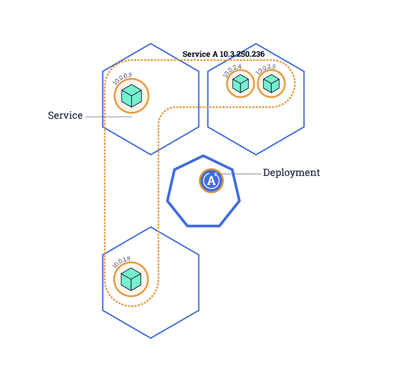
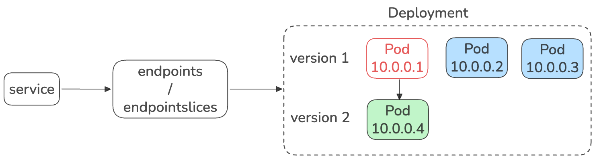
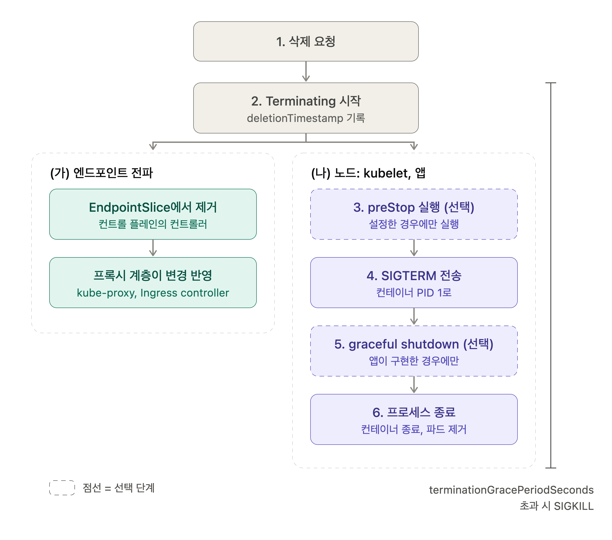
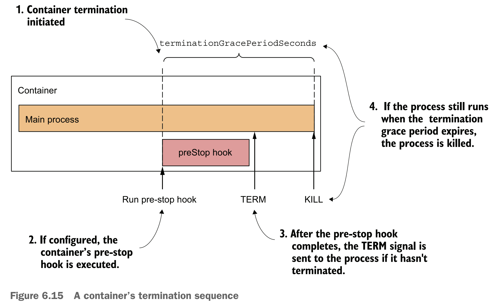
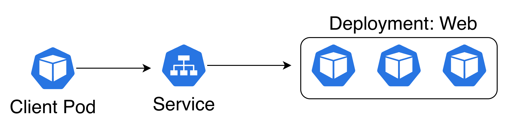

## 요약

> - 쿠버네티스에서 RollingUpdate를 통해 Deployment를 무중단으로 배포하는 방법을 알아봅니다.
> - preStop 훅과 terminationGracePeriodSeconds을 통해 Graceful하게 종료하는 방법을 알아봅니다.

## 들어가며

오늘날 대부분의 서비스들은 사용자들이 알아채지도 못하게 업데이트가 진행됩니다. 만약 우리가 배달의 민족에서 음식을 주문하고 결재하는 데 신규 기능 배포로 인해 서비스가 내려가면 어떻게 될까요?
혹은 우리가 토스에서 친구에게 계좌이체를 하는 도중에 서비스가 내려간다면요? 아마 이런 일들을 사용자들은 상상조차 하고 싶지 않아할 것입니다. 하지만 엔지니어들은 이런 상황을 매우 자세히 상상하고 고려해서 배포를 해야합니다.

그렇다면 쿠버네티스에서는 어떻게 서비스 중단 없이 자연스러운 배포가 가능할까요?

## 무중단 배포란

무중단 배포란 뭘까요? 말그대로 서비스 중단이 발생하지 않고 신규 배포가 이뤄지는 것을 의미합니다.

그렇다면 서비스 중단이 일어나지 않으려면 배포 과정에서 두 가지 조건을 만족해야합니다.

- 첫째, Active 서버 개수가 줄어들면 안된다

- 둘째, 어떤 시점에도 요청을 처리할 수 있어야 한다

이제 쿠버네티스에서 이 두 가지 조건을 만족하면서 배포를 수행하는 방법을 알아보겠습니다.

## 쿠버네티스에서 Rolling Update

*다양한 배포 전략이 있지만, 이번 글에서는 Deployment 객체의 Rolling Update를 기준으로 설명합니다.*


[^1]

Deployment는 두 가지 업데이트 전략 유형을 지원합니다.[^2]

- **RollingUpdate (기본값)**: 기존 파드를 새 파드로 점진적으로 교체합니다.
- **Recreate**: 새 파드를 만들기 전에 기존 파드를 모두 종료합니다. 이 방식은 다운타임이 발생합니다.

RollingUpdate 전략에서는 아래 파라미터로 쿠버네티스가 업데이트를 수행하는 방식을 제어할 수 있습니다.

| 파라미터 | 제어 대상 | 기본값 | 예시 |
|---|---|---|---|
| `maxUnavailable` | 업데이트 중 사용할 수 없는 상태가 될 수 있는 파드의 최대 개수 | 25% | `1` 또는 `25%` |
| `maxSurge` | 업데이트 중 추가로 생성할 수 있는 파드의 최대 개수 | 25% | `1` 또는 `25%` |

결론은 Deployment는 RollingUpdate 방식으로 파드가 교체되며, `maxSurge`값 만큼 신규 버전 파드가 먼저 뜨고, `maxUnavailable` 값 만큼 기존 파드를 내릴 수 있습니다.

우리는 이를 통해 무중단 배포의 첫 번째 조건인 "Active 서버 개수가 줄어들면 안된다"를 달성할 수 있습니다.

- `maxUnavailable` 값을 0으로 설정하면 업데이트 중 사용할 수 없는 상태가 될 수 있는 파드의 최대 개수가 0이 보장되기 때문입니다.
- `maxSurge` 값을 1보다 크게 한다면 원래 Active 서버 개수보다 maxSurge 수 만큼 추가된 Active 서버 개수를 가지게 됩니다.

여기까지 설정한다면 두 번째 조건인 "어떤 시점에도 요청을 처리할 수 있어야 한다"도 만족하는 것처럼 보입니다. 기존 Pod 수도 줄지 않고, 신규 버전을 배포할 수 있기 때문입니다.
하지만 이는 틀렸습니다. 왜 그럴까요?

## Rolling Update 과정에서의 인입 트래픽 분석

`maxSurge`가 1이고 `maxUnavailable`이 0으로 설정된 Deployment의 RollingUpdate 과정을 상상해 봅시다. 신규 버전 파드(10.0.0.4)가 생성되어 Ready 상태가 되면, 쿠버네티스는 기존 버전 파드(10.0.0.1)의 삭제를 시작하고 이 파드는 Terminating 상태가 됩니다.



바로 여기서 문제가 발생합니다.

1. **처리 중 요청 유실**: 기존 파드(10.0.0.1)가 요청을 처리하던 도중 종료 신호를 받고 앱이 그대로 종료된다면?
2. **종료 중인 파드로의 신규 요청 유입**: 기존 파드(10.0.0.1)가 Terminating 중인데도 새 요청이 계속 들어온다면?

왜 이런 문제가 발생할까요? 케이스별로 나누어 살펴보겠습니다.

**1번 케이스: 처리 중 요청 유실**

이 문제는 삭제가 시작되는 순간에 파드 안에 처리 중인 요청이 있는지에 달려 있습니다. 운 좋게 그 순간 처리 중인 요청이 하나도 없다면 아무 일도 일어나지 않겠지만, 서비스의 가용성을 그런 우연에 맡길 수는 없습니다. 앱이 SIGTERM을 받자마자 종료한다면 처리 중이던 요청은 응답을 돌려주지 못하고 끊기게 됩니다.

**2번 케이스: 종료 중인 파드로의 신규 요청 유입**

이 케이스는 조금 다릅니다. 얼핏 보면 이상합니다. 파드가 Terminating 상태라면 Service가 바라보는 Endpoints/EndpointSlice에서 10.0.0.1은 이미 빠졌을 텐데, 왜 그쪽으로 요청이 올까요?

이유는 파드 삭제가 시작되는 순간 두 가지 일이 **동시에** 벌어지기 때문입니다.

- Endpoints에서 파드가 제거되고, 그 변경이 API server를 거쳐 각 노드의 kube-proxy(iptables)나 Ingress controller 같은 소비자에게 전파되어 반영되는 일
- 컨테이너에 SIGTERM이 전달되는 일

앱은 신호를 받는 즉시 반응하지만, 변경이 모든 노드에 반영되기까지는 시간이 걸립니다. 그 사이 아직 갱신되지 않은 노드에서는 이미 종료 중인 10.0.0.1로 요청을 계속 전달하게 되고, 이 요청은 실패합니다.


## 문제 해결

인입 트래픽 분석을 통해 알 수 있는 문제의 핵심은 아래 두 가지입니다.

- 파드가 내려가는 동안 신규 트래픽이 못들어오게 막는 것
- 들어온 트래픽을 일단 처리 후 반환하는 것


파드가 내려가는 동안 신규 트래픽이 못들어오게 막는 것은 애플리케이션이 아닌 쿠버네티스의 책임입니다. 쿠버네티스에서는 이를 Endpoints/EndpointSlices 객체 갱신과 kube-proxy를 통한 iptables 갱신을 통해 수행합니다. 하지만 이는 위에서 알아본대로 처리 속도에 따라 지연이 발생할 수 있고 이 과정에 일부 트래픽이 기존 파드로 인입됩니다.

그렇다면 파드가 내려가는 동안 들어온 트래픽을 처리 하게 하는 것은 어떻게 할 수 있을까요?

우선 파드가 삭제 되는 동안 일어나는 일을 살펴봅시다.




- 엔드포인트 전파
    - kube-controller-manager안에서 돌고 있는 Endpoint/EndpointSlice 컨트롤러가 Pod 상태를 watch하고 있다가 변경이 생기면 갱신을 수행합니다
    - kube-proxy는 Endpoint/EndpointSlice 객체를 watch하고 있다가 변경이 생기면 노드의 iptables를 통해 변경해 갱신 내용을 전파 합니다.
    - ingress controller는 Endpoint/EndpointSlice 객체를 watch하고 있다가 변경이 생기면 해당 설정을 반영
- 워커 노드 (Kubelet)
    - `preStop` 훅 실행 (있다면, 끝날 때까지 대기)
    - 컨테이너 런타임이 컨테이너의 PID 1에 SIGTERM 전송
    - 프로세스 종료 → 컨테이너 종료 → 파드 제거
    - `terminationGracePeriodSeconds` 시간이 끝나도 안 끝났으면 SIGKILL


쿠버네티스에서는 파드를 종료할 때 `terminationGracePeriodSeconds` 시간 만큼 종료를 기다려주는 설정이 있습니다. 또한 `preStop` 훅 설정을 통해 SIGTERM을 컨테이너에 날리기전에 어떤 동작을 수행할 수 있게 끔 설정할 수 도 있습니다.

위 두 설정을 조합하면 앞선 문제(파드가 내려가는 동안 들어온 트래픽을 처리)를 해결할 수 있습니다.

> 먼저 `preStop` 훅 설정을 통해 `preStop sleep T`을 설정해두면 T 시간 동안 SIGTERM을 유예할 수 있습니다. -> 이걸 이용해서 엔드포인트 전파가 될 때까지 앱이 정상 동작하도록 할 수 있습니다.
> 
> 또한 `terminationGracePeriodSeconds` 시간을 (엔드포인트 전파 최대 시간) + (요청 처리 최대 시간) 보다 길게 설정하면 안전하게 현재 들어온 요청을 모두 처리하고 반환하게 끔 보장할 수 있습니다.

 [^3]

## 실습

*엔드포인트 전파 지연을 모의로 구현하기 위해 kube-proxy minSyncPeriod를 10초로 설정했습니다*

이번 실습은 로컬에 `kind`를 통해 쿠버네티스 클러스터를 구성합니다.

```bash
git clone https://github.com/chjung99/k8s-labs.git
cd ~/k8s-labs/01-zero-downtime-deploy 

kind create cluster --name graceful-lab --config ./kind-config.yaml
kubectl config use-context kind-graceful-lab
docker build -t fastapi-graceful:1 app/
kind load docker-image fastapi-graceful:1 --name graceful-lab

# kube-proxy 설정 확인
kubectl -n kube-system get cm kube-proxy -o yaml | grep -A6 "iptables:"
```

Deployment를 RollingUpdate하는 동안 Service를 통한 클러스터 내부 통신을 시도합니다.



- Deployment (web, 3 replicas)
- Service (web)
- Pod(Client - loadgen)

### 실험 조건

| 항목 | A (실패 케이스) | B (성공 케이스) |
|---|---|---|
| 앱 종료 방식 | SIGTERM 즉시 종료 (`os._exit`) | uvicorn graceful shutdown |
| `preStop` | 없음 | `sleep 12` |
| `terminationGracePeriodSeconds` | 30초 (기본값) | 40초 |
| 롤링 업데이트 | `maxUnavailable: 0`, `maxSurge: 1` | 동일 |
| 레플리카 | 3 | 동일 |
| kube-proxy | `minSyncPeriod: 10s` (틈 확대) | 동일 |
| 부하 | 워커 2개, 요청 간격 1초, 요청당 처리 5초 | 동일 |

### 실패 케이스 (A)

```bash
kubectl apply -f ./manifests/deploy-a.yaml
kubectl rollout status deploy/web
kubectl apply -f ./manifests/loadgen.yaml
kubectl logs -f loadgen                 # 정상 로그(code=200)가 쌓이는지 확인
# 다른 터미널에서 배포 트리거
kubectl rollout restart deploy/web
kubectl get pods -w
# 배포가 끝나고 ~30초 뒤 집계
kubectl logs loadgen | grep -o 'code=[0-9]*' | sort | uniq -c
kubectl logs loadgen | grep -v 'code=200'
```

#### 집계

| 결과 | 건수 | 비율 |
|---|---|---|
| 성공 (`code=200`) | 28 | 87.5% |
| 실패 (`code=000`) | 4 | 12.5% |
| 합계 | 32 | |

#### 실패 상세

| 요청 시작 | 워커 | `rc` | 소요 시간 | curl 메시지 | 해석 | 문제 유형 |
|---|---|---|---|---|---|---|
| 03:25:40 | w1 | 52 | 0.62초 | Empty reply from server | 정상이면 5초 걸릴 요청이 0.6초 만에 끊김 | 처리 중 요청 유실 |
| 03:25:40 | w2 | 52 | 1.60초 | Empty reply from server | 정상이면 5초 걸릴 요청이 1.6초 만에 끊김 | 처리 중 요청 유실 |
| 03:25:42 | w1 | 28 | 15.00초 | Connection timed out | 연결이 맺어지지 않아 15초 대기 후 포기 | 종료 중인 파드로의 신규 요청 유입 |
| 03:25:43 | w2 | 28 | 15.00초 | Connection timed out | 연결이 맺어지지 않아 15초 대기 후 포기 | 종료 중인 파드로의 신규 요청 유입 |

#### 해석

- **`rc=52`는 처리 중이던 요청이 끊긴 것입니다.** 요청이 시작된 지 0.6~1.6초 만에 서버가 데이터 없이 연결을 닫았고, 이는 정상 처리 시간(5초)보다 훨씬 짧습니다. SIGTERM을 받은 앱이 `os._exit(1)`로 즉시 종료한 것과 일치합니다.
- **`rc=28`은 종료 중인 파드로 새 요청이 간 것입니다.** 요청이 시작된 시점은 위 실패보다 2~3초 뒤이고, 연결 자체가 맺어지지 않았습니다. 파드는 이미 Endpoints에서 빠졌지만 kube-proxy의 iptables에 규칙이 남아 있어(`minSyncPeriod: 10s`) 이미 사라진 파드 IP로 요청이 전달된 것으로 해석됩니다.
- 두 실패는 원인이 다릅니다. 전자는 앱의 종료 방식 문제이고 후자는 전파 지연 문제입니다.

### 성공 케이스 (B)

```bash
kubectl delete pod loadgen
kubectl apply -f ./manifests/deploy-b.yaml
kubectl rollout status deploy/web
kubectl apply -f ./manifests/loadgen.yaml
kubectl logs -f loadgen                 # 정상 로그(code=200)가 쌓이는지 확인
# 다른 터미널에서 배포 트리거
kubectl rollout restart deploy/web
kubectl get pods -w
# 배포가 끝나고 ~30초 뒤 집계
kubectl logs loadgen | grep -o 'code=[0-9]*' | sort | uniq -c
```

#### 집계

| 결과 | 건수 | 비율 |
|---|---|---|
| 성공 (`code=200`) | 32 | 100% |
| 실패 (`code=000`) | 0 | 0% |
| 합계 | 32 | |

#### 해석

- 같은 조건에서 실패가 발생하지 않았습니다. A에서 나온 `rc=52`와 `rc=28`이 모두 사라졌습니다.
- `preStop` sleep 12초가 SIGTERM을 늦춰 Endpoints 변경이 전파될 시간을 벌어 주었고, SIGTERM 이후에는 graceful shutdown이 진행 중이던 요청을 마무리한 것으로 해석됩니다.


### 실패 케이스 (A)와 성공 케이스 (B) 비교

| 항목 | A | B |
|---|---|---|
| 총 요청 | 32 | 32 |
| 성공 | 28 | 32 |
| 실패 | 4 | 0 |
| `rc=52` (처리 중 요청 유실) | 2 | 0 |
| `rc=28` (신규 요청 유입) | 2 | 0 |


[^1]: https://kubernetes.io/docs/tutorials/kubernetes-basics/update/update-intro/
[^2]: https://kubernetes.io/docs/tasks/run-application/update-deployment-rolling/#configuring-rolling-update-strategy
[^3]: https://www.manning.com/books/kubernetes-in-action