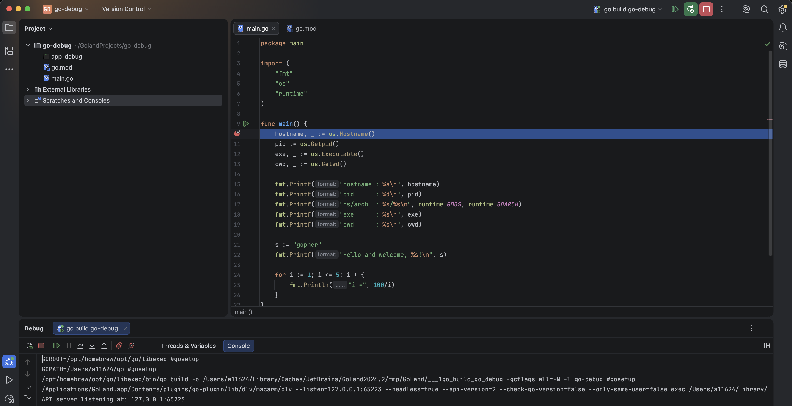
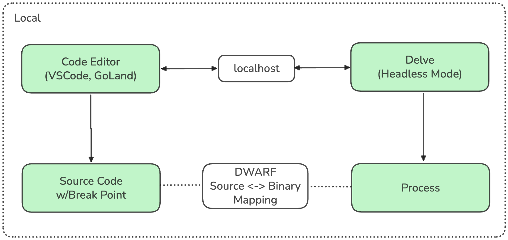
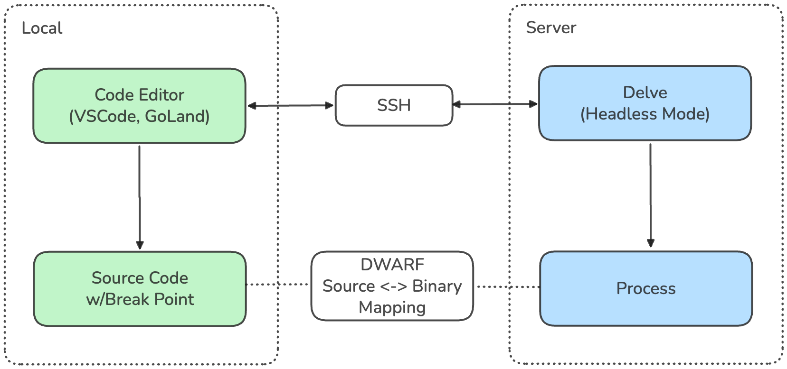
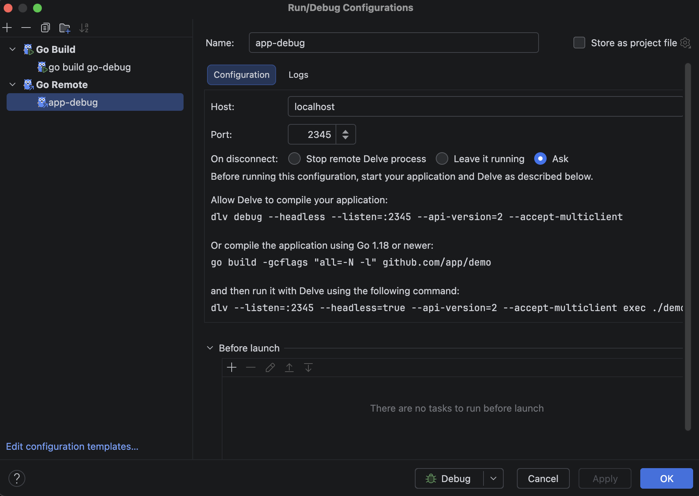
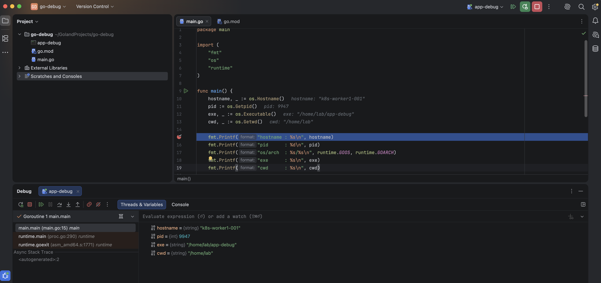
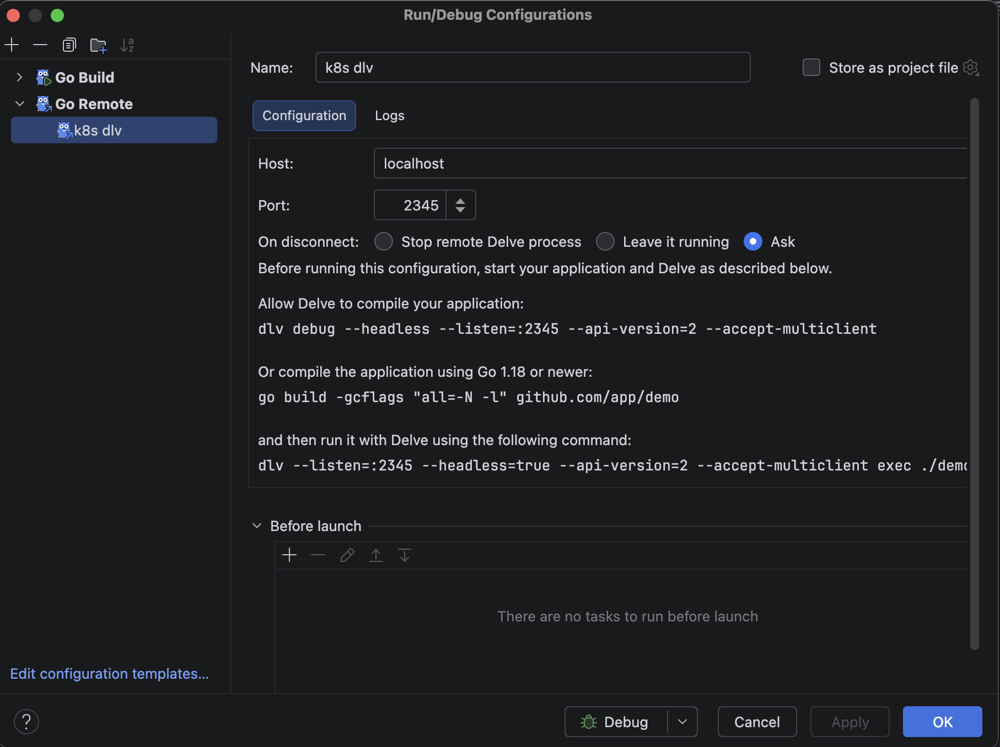
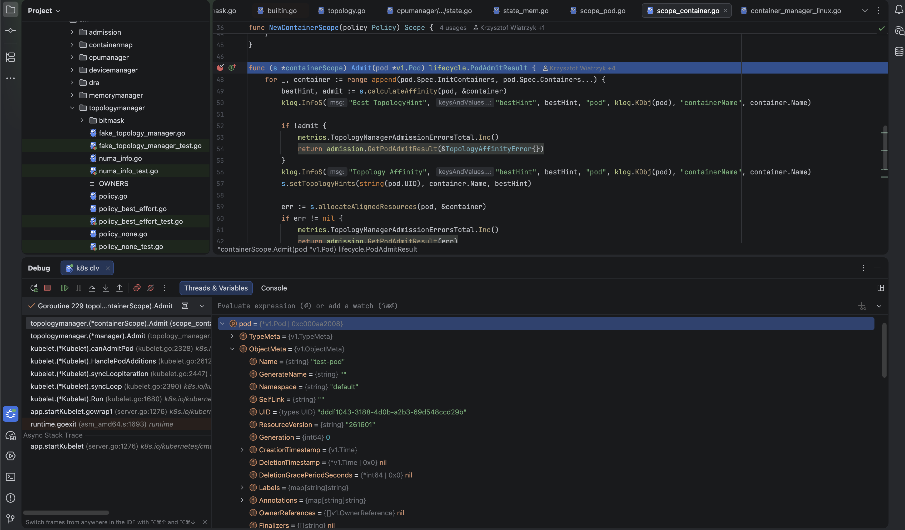

## 요약

> - Delve를 활용하여 쿠버네티스 원격 디버깅 방법을 정리합니다.
> - 원격 디버깅을 위한 코드 에디터 설정 및 빌드 옵션 설정 등 실습을 다룹니다.

## 들어가며

우리는 프로그램을 개발할 때 코드가 어떻게 동작하는 지 직접 확인하기 위해 디버깅을 합니다. 로컬에서 실행할 수 있는 코드라면 코드 에디터를 사용하면서 브레이크 포인트를 지정하고 디버깅 기능을 실행하면 됩니다. 그런데 만약 쿠버네티스 코드를 디버깅하려면 어떻게 해야 할까요?

일반적으로는 쿠버네티스 코드를 디버깅할 일이 없지만, 쿠버네티스 일부를 커스텀해야하거나 세부 동작을 확인하고 싶을 때 아래 방법을 활용할 수 있습니다.

## 로컬 디버깅

한번 간단한 go 프로그램을 로컬에서 디버깅 해보겠습니다. 원하는 지점에 Break Point를 걸어두고 디버그 버튼을 눌러주면 아래와 같은 화면이 나옵니다.



콘솔 출력 부분을 집중에서 확인해보겠습니다.

```
GOROOT=/opt/homebrew/opt/go/libexec #gosetup
GOPATH=/Users/username/go #gosetup
/opt/homebrew/opt/go/libexec/bin/go build -o /Users/username/Library/Caches/JetBrains/GoLand2026.2/tmp/GoLand/___1go_build_go_debug -gcflags all=-N -l go-debug #gosetup
/Applications/GoLand.app/Contents/plugins/go-plugin/lib/dlv/macarm/dlv --listen=127.0.0.1:65223 --headless=true --api-version=2 --check-go-version=false --only-same-user=false exec /Users/a11624/Library/Caches/JetBrains/GoLand2026.2/tmp/GoLand/___1go_build_go_debug -- #gosetup
API server listening at: 127.0.0.1:65223
```

각 줄을 살펴보면,

- GOROOT, GOPATH를 설정해주고
- `-gcflags all=-N -l` 옵션을 설정해서 소스 코드를 빌드하고
- dlv라는 도구를 127.0.0.1:65223에서 동작시키면서 방금 빌드한 소스코드 바이너리를 함께 exec 합니다

### 옵션 (`-gcflags all=-N -l`) 알아보기

`-gcflags all=-N -l`옵션은 디버거가 소스 코드 기준으로 변수와 실행 흐름을 정확히 보여주게 하려고, 컴파일러의 최적화를 꺼두는 옵션입니다.

| 부분 | 의미 |
|---|---|
| `-gcflags` | Go 컴파일러(gc)에 넘기는 옵션 |
| `all=` | 내 코드뿐 아니라 의존 패키지와 표준 라이브러리에도 적용 |
| `-N` | 최적화 끄기 |
| `-l` | 인라이닝 끄기 (함수 호출을 호출 자리에 펼쳐 넣는 최적화) |


최적화를 켜면 컴파일러가 코드를 소스와 다르게 바꿔버려서, 디버거가 보여주는 모습이 소스와 어긋나기 때문입니다. 
옵션을 주면 소스와 기계어가 거의 1:1로 대응해서, 변수가 다 보이고 한 줄씩 따라가는 디버깅이 자연스럽게 됩니다.

### dlv(Delve) 알아보기

Delve는 Go 언어 전용 디버거이고, dlv는 그 실행 명령어입니다. Go 프로세스를 제어하면서 중단점을 걸고, 변수와 스택을 읽고, 한 줄씩 실행하게 해주는 엔진입니다.

| 명령 | 하는 일 |
|---|---|
| `dlv debug` | 소스를 디버그용으로 빌드하고 바로 디버깅 시작 |
| `dlv exec ./app` | 이미 빌드된 바이너리를 Delve가 실행하며 디버깅 |
| `dlv attach <PID>` | 이미 돌고 있는 프로세스에 붙기 |
| `dlv test` | 테스트 코드를 디버깅 |
| `dlv core ./app core파일` | 죽은 프로세스의 코어 덤프를 사후 분석 |

GDB 같은 범용 디버거로도 Go를 디버깅할 수는 있지만, Go의 런타임 구조를 잘 모릅니다. Go는 OS 스레드 위에 고루틴이라는 자체 실행 단위를 얹어 쓰고, 슬라이스, 맵, 채널, 인터페이스 같은 Go 특유의 타입이 있습니다. Delve는 이런 구조를 이해해서 다음을 할 수 있어요.

- 고루틴 목록을 보고 고루틴 단위로 스택을 전환
- 슬라이스, 맵, 채널의 내용을 Go 방식으로 해석해서 표시
- Go 컴파일러가 남기는 DWARF 정보를 정확히 해석

참고로 여기서 DWARF란 컴파일된 바이너리 안에 함께 저장되는 디버깅용 정보의 표준 형식입니다. 기계어와 소스 코드를 이어주는 번역 사전 역할을 합니다.
컴파일하면 줄 번호, 변수 이름, 타입 같은 정보가 기계어에서 사라지는데, 디버거는 "main.go 12번 줄에서 i가 5"라고 사람에게 보여줘야 해서, 사라진 정보를 복원할 단서가 필요하고 그게 DWARF입니다.


### 로컬 디버깅 구조

정리하면 로컬 코드 에디터에서 디버깅을 할 때 실제 내부에서는 아래와 같은 구조로 동작합니다.



## 원격 디버깅

(*이 글은 로컬과 원격 서버가 SSH로 통신 가능한 경우를 가정해서 작성했습니다.*)

구조는 매우 간단합니다. 로컬 디버깅 구조에서 localhost로 통신했던 것만 SSH로 변경됩니다.

그리고 로컬에서 빌드한 바이너리를 서버에서 Delve를 통해 실행하면 코드 에디터에서 디버깅할 수 있습니다.




### 예제

OS 정보를 출력하는 간단한 프로그램을 로컬에서 빌드한 뒤 서버에서 실행하여 디버깅해보겠습니다.

```go
package main

import (
	"fmt"
	"os"
	"runtime"
)

func main() {
	hostname, _ := os.Hostname()
	pid := os.Getpid()
	exe, _ := os.Executable()
	cwd, _ := os.Getwd()

	fmt.Printf("hostname : %s\n", hostname)
	fmt.Printf("pid      : %d\n", pid)
	fmt.Printf("os/arch  : %s/%s\n", runtime.GOOS, runtime.GOARCH)
	fmt.Printf("exe      : %s\n", exe)
	fmt.Printf("cwd      : %s\n", cwd)

	s := "gopher"
	fmt.Printf("Hello and welcome, %s!\n", s)

	for i := 1; i <= 5; i++ {
		fmt.Println("i =", 100/i)
	}
}

```

### 1. 로컬에서 빌드하기

현재 로컬은 MacOS (arm64)이고, 서버는 우분투 OS (amd64)이므로 아래 옵션을 추가해 빌드해줍니다.

바이너리 실행 환경이 달라져서 추가된 옵션을 제외하곤, 로컬 디버깅 때와 동일합니다.

```bash
CGO_ENABLED=0 GOOS=linux GOARCH=amd64   go build   -gcflags="all=-N -l"   -o app-debug   .
└──── 환경변수 (빌드 환경 지정) ────┘        └ 명령 ┘     └── 컴파일러 옵션 ──┘     └ 출력 ┘     └ 대상
```

| 변수 | 의미 |
|---|---|
| `GOOS=linux` | 결과물을 실행할 **운영체제**는 리눅스 |
| `GOARCH=amd64` | 결과물을 실행할 **CPU 종류**는 x86-64 |
| `CGO_ENABLED=0` | C 코드 연동(cgo)을 끔 |

이 두 가지(`GOOS`, `GOARCH`)가 **크로스 컴파일**의 핵심이에요. 지금 빌드하는 곳은 맥(darwin/arm64)이지만, 결과물은 VM(linux/amd64)에서 돌아야 하니까 "대상은 이거야"라고 알려주는 겁니다. Go는 별도 도구 없이 이 변수만 바꿔도 다른 플랫폼용 바이너리를 만들 수 있어요.

`CGO_ENABLED=0`을 쓰는 이유는 cgo를 켜면 C 컴파일러와 리눅스용 C 라이브러리가 빌드 환경에 필요해서 맥에서 크로스 컴파일이 실패하기 쉽기 때문이에요. 끄면 **순수 Go 코드만으로 빌드**되고, 외부 라이브러리에 의존하지 않는 정적 바이너리가 나와서 VM에 옮겨도 라이브러리 문제 없이 실행됩니다.

빌드 실행 결과로 `app-debug`라는 바이너리 파일이 생성됩니다.

```bash
ls -l
total 5096
-rwxr-xr-x@ 1 user  group  2597575 Oct 14 21:51 app-debug
-rw-r--r--@ 1 user  group       25 Oct 14 20:59 go.mod
-rw-r--r--@ 1 user  group      497 Oct 14 21:51 main.go
```


### 2. 로컬에서 빌드한 바이너리를 서버로 전달하기

```bash
scp ./app-debug {USER}@{HOST}:{DIR}/app-debug
```

### 3. 서버에서 Delve 설치하기
   
`서버에서 Delve를 설치하는 공식 방법은 아래 명령어를 실행하는 것입니다. 다만 해당 방식은 서버에서 go를 설치해야하고, 버전을 맞춰줘야 하는 사전 작업이 필요합니다.
```bash
go install github.com/go-delve/delve/cmd/dlv@latest
```

저의 경우 서버에 설치된 go 버전이 낮아서 거기에 맞는 dlv 버전을 찾는 것보단 로컬에서 dlv 역시 빌드해서 바이너리만 가져오는 방식을 택했습니다. 참고로 Go는 결과물이 의존성 없는 단일 바이너리라서, 서버에는 실행 파일만 있으면 되고 컴파일러는 필요 없습니다. 이게 Go의 큰 장점입니다.

따라서 아래 명령어 대로 로컬에서 빌드 후 서버로 넘겨줄 수 있습니다.

```bash
set -euo pipefail
OUT_DIR="$HOME/dlv-out"
TMP="$(mktemp -d)"
mkdir -p "$OUT_DIR"
cd "$TMP"
go mod init dlvbuild
GOFLAGS=-mod=mod go get github.com/go-delve/delve/cmd/dlv@latest
GOOS=linux GOARCH=amd64 CGO_ENABLED=0 go build -o "$OUT_DIR/dlv" github.com/go-delve/delve/cmd/dlv
rm -rf "$TMP"
file "$OUT_DIR/dlv"
```

```bash
scp ~/dlv-out/dlv {USER}@{HOST}:~/
ssh {USER}@{HOST} 'chmod +x ~/dlv && ~/dlv version'
```

??? tip "Go 빌드 자세히 알아보기"
    **Go는 프로그램을 돌리는 데 필요한 것을 전부 실행 파일 하나 안에 넣어서 만들어요.** 그래서 그 파일만 서버에 올리면 서버에는 Go 관련 아무것도 깔려 있지 않아도 실행됩니다.

    Python 프로그램을 서버에서 돌리려면 서버에 이런 것들이 있어야 해요.

    - Python 인터프리터 (그것도 호환되는 버전으로)
    - 프로그램이 쓰는 라이브러리 (`pip install`로 설치한 것들)

    파일(`.py`)만 옮겨서는 안 돌아가고, **실행 환경을 서버에 똑같이 구성**해야 하죠.

    Go는 이렇게 달라요.

    | | Python | Go |
    |---|---|---|
    | 서버에 옮기는 것 | 소스 파일 + (라이브러리 설치) | 실행 파일 하나 |
    | 서버에 필요한 것 | 인터프리터, 라이브러리 | 없음 (리눅스 커널만 있으면 됨) |
    | 실행 | `python app.py` | `./app` |


    Go 컴파일러는 빌드할 때 이것들을 **전부 합쳐서 하나의 파일로** 만들어요.

    - 내가 쓴 코드
    - 내가 가져다 쓴 외부 라이브러리 코드
    - 표준 라이브러리(`fmt` 같은 것들)
    - Go 런타임 (고루틴 스케줄러, 가비지 컬렉터 등)

    즉 "실행에 필요한 부품"이 파일 안에 이미 들어 있어서, 서버에서 따로 가져올 게 없어요. 이런 방식을 **정적 링킹**이라고 합니다. 앞에서 `CGO_ENABLED=0`으로 빌드한 이유도 이거예요. cgo를 켜면 시스템의 C 라이브러리를 빌려 쓰게 돼서 "서버에 그 라이브러리가 있어야 한다"는 의존성이 생기는데, 끄면 정말 완전히 혼자 돌아가는 파일이 나옵니다.`


### 4. 서버에서 Delve로 바이너리 실행하기

```bash
~/dlv exec ./app-debug --headless --listen=127.0.0.1:2345
```


### 5. 로컬 코드에디터에서 서버 연결하기 (GoLand)

먼저 로컬에서 서버와 SSH 연결을 만들어 로컬 포트 포워딩을 수행하도록 설정합니다


```bash
ssh -L 2345:127.0.0.1:2345 {USER}@{HOST}
```


이후 코드 에디터(GoLand)에서 Run/Debug Configuration에서 GoRemote를 클릭해 Add Configuration을 선택합니다. 
그리고 아래와 같이 Host와 Port를 설정해주면 됩니다. 




### 6. 원격 디버깅 수행하기
    
이제 위에서 생성한 app-debug라는 Configuration으로 실행하도록 설정하고, break point를 건 뒤 디버그를 실행하면 아래와 같이 실제 원격 호스트 이름이 나오는 걸 확인할 수 있습니다. 




## 쿠버네티스 원격 디버깅하기

이제 본론입니다. 지금까지 알아본대로 동일한 과정을 거치면 됩니다. 쿠버네티스의 많은 컴포넌트 중에 `Kubelet`을 디버깅해보겠습니다.

### 1. 로컬에서 빌드하기

먼저 Goland Project에 clone 받았던 kubernetes에서 `/cmd/kubelet` 부분을 로컬에서 빌드합니다.

```bash
cd ~/GolandProjects/kubernetes
mkdir -p ~/kubelet-build
VERSION=$(git describe --tags --abbrev=0)   # 예: v1.30.14

GOOS=linux GOARCH=amd64 CGO_ENABLED=0 \
go build -gcflags "all=-N -l" \
  -ldflags "-X k8s.io/component-base/version.gitVersion=$VERSION -X k8s.io/client-go/pkg/version.gitVersion=$VERSION" \
  -o ~/kubelet-build/kubelet ./cmd/kubelet
```

### 2. 로컬에서 빌드한 바이너리를 서버로 전달하기

```bash
gzip -c ~/kubelet-build/kubelet | ssh {USER}@{HOST} 'gunzip > /tmp/kubelet.new'
```

### 3. 서버에서 Delve로 바이너리 실행하기

```bash
# 변수 (경로는 환경에 맞게 수정)
PORT=2345
DLV=~/dlv
LOG=/tmp/dlv-kubelet.log

# kubelet 중지 + 이전 dlv 정리
sudo systemctl stop kubelet
sudo pkill -f "dlv.*--listen=.*:$PORT" 2>/dev/null || true
sleep 1
pgrep -a kubelet || echo "kubelet 프로세스 없음 (정상)"

# 바이너리 교체 (원본은 최초 1회만 백업)
[ -f /usr/bin/kubelet.orig ] || sudo cp -p /usr/bin/kubelet /usr/bin/kubelet.orig
sudo install -m 755 /tmp/kubelet.new /usr/bin/kubelet

# systemd가 넘기던 인자 재현 (kubeadm이 생성한 파일)
source /var/lib/kubelet/kubeadm-flags.env

sudo nohup "$HOME/dlv" \
    --headless --listen="127.0.0.1:2345" --api-version=2 --accept-multiclient \
    --only-same-user=false \
    exec --continue /usr/bin/kubelet -- \
    --bootstrap-kubeconfig=/etc/kubernetes/bootstrap-kubelet.conf \
    --kubeconfig=/etc/kubernetes/kubelet.conf \
    --config=/var/lib/kubelet/config.yaml \
    $KUBELET_KUBEADM_ARGS \
    > /tmp/dlv-kubelet.log 2>&1 &
```

### 4. 로컬 코드에디터에서 서버 연결하기 (GoLand)

먼저 로컬에서 서버와 SSH 연결을 만들어 로컬 포트 포워딩을 수행하도록 설정합니다


```bash
ssh -L 2345:127.0.0.1:2345 {USER}@{HOST}
```

이후 코드 에디터(GoLand)에서 Run/Debug Configuration에서 GoRemote를 클릭해 Add Configuration을 선택합니다. 
그리고 아래와 같이 Host와 Port를 설정해주면 됩니다. 



### 5. 원격 디버깅 수행하기

이제 위에서 설정한 k8s dlv 라는 Configuration으로 실행하도록 설정하고, break point를 `pkg/kubelet/cm/topologymanager/scope_container.go` 파일안에 `func (s *containerScope) Admit(pod *v1.Pod) lifecycle.PodAdmitResult` 함수에 건 뒤 디버그를 실행하겠습니다.

해당 부분은 실제 Pod 속 컨테이너를 생성할 때 거치는 함수로, 파드가 생성될 때 실행됩니다.

따라서 아래와 같이 테스트용 Pod를 생성해주겠습니다.

```bash
kubectl run test-pod --image=nginx --restart=Never --overrides='{"spec":{"nodeSelector":{"kubernetes.io/hostname":"k8s-worker1-001"}}}'
```

Pod가 생성 명령어가 들어오자마자 아래와 같이 실제 Pod Spec 변수들을 확인할 수 있습니다.

