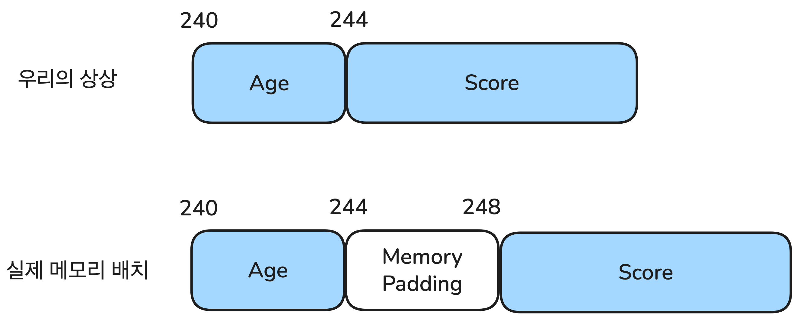
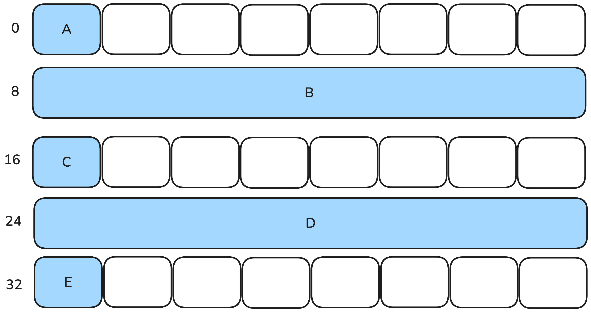
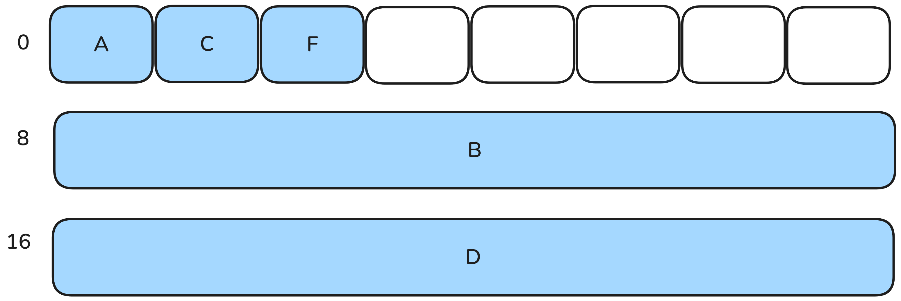
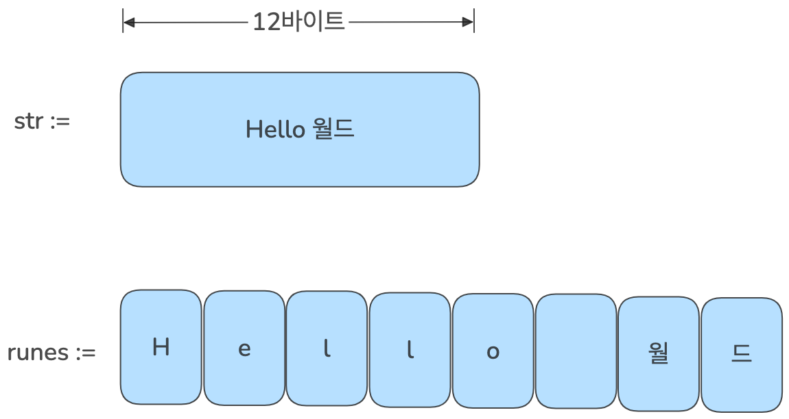
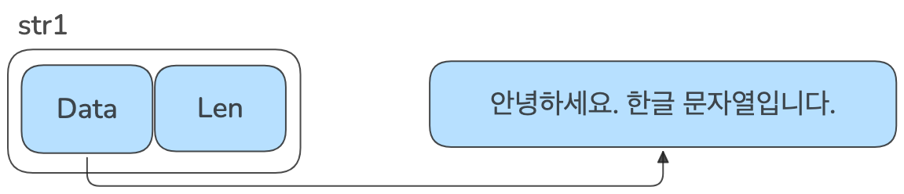
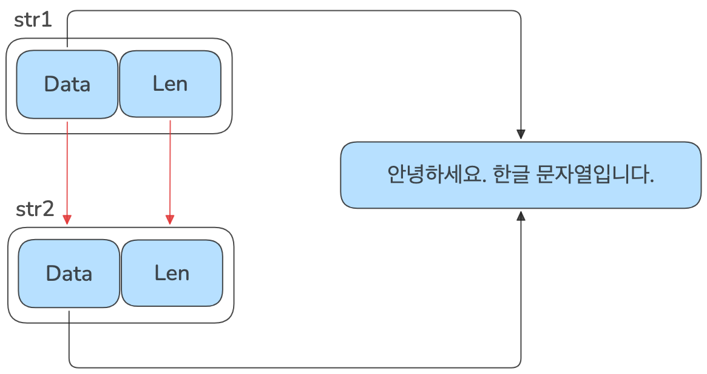
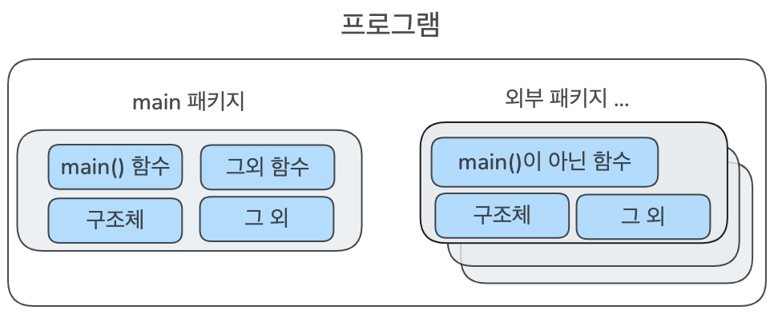

## 요약

> - "Tucker의 Go 언어 프로그래밍"을 책을 읽고 내용을 정리합니다.
> - 1단계 탄탄하게 기초 문법 다지기 내용을 다룹니다.

## 10장. 배열

### 배열

- 배열(array)은 같은 타입의 데이터들로 이루어진 자료구조입니다.
- 배열에 담을 수 있는 최대 요소 개수는 생성할 때 고정되어, 중간에 늘리거나 줄일 수 없습니다.
- 배열은 데이터 타입 앞에 `[]`를 붙여 만듭니다.
- 대괄호 [] 사이에 인덱스를 넣어 배열 요소에 접근할 수 있습니다.
- 배열 선언 시 개수는 항상 상수로 써야 합니다. 변숫값을 배열 개수로 사용할 수 없습니다.

### 배열 변수 선언 및 초기화

```go
// var 변수명 [요소 개수]타입
var num [5]int
```

- 별도로 초깃값을 지정하지 않아 `int` 타입의 기본 값인 0으로 초기화됩니다.

```go
days := [3]string{"monday", "tuesday", "wednesday"}
```

- `string` 타입 요소 3개를 갖는 배열 `days`를 할당합니다. 각 요솟값을 지정한 값으로 초기화합니다.

```go
x := [...]int{10, 20, 30}
```

- `...`을 사용해 배열 요소  개수를 생략할 수 있습니다.
- 이때 배열 요소 개수는 초기화되는 요소 개수와 같습니다

### 배열은 연속된 메모리

- 배열을 선언하면 컴퓨터는 연속된 메모리 공간을 확보합니다. 예를 들어 아래와 같이 선언하면

```go
var a [10]int32
```

- 컴퓨터는 `int32`값 10갸를 저장할 수 있는 연속된 메모리 공간을 찾아 할당합니다. (int32 타입은 4바이트이므로 연속된 40바이트 확보)

- 컴퓨터는 인덱스에 해당하는 요소를 찾아갈 때, 배열의 시작 주소에 `인덱스 x 타입 크기`를 더해서 찾아갑니다.

### 배열 복사

- 대입 연산자를 사용하면 배열 대 배열 복사를 할 수 있습니다.

```go
a := [5]int{1, 2, 3, 4, 5}
b := [5]int{6, 7, 8, 9 ,10}

b = a // b 배열 모든 값에 a 값 복사 (주소 복사가 아님)
```

- Go 언어에서 모든 연산자의 각 항의 타입은 항상 같아야합니다. 대입 연산자도 마찬가지입니다.
- 그래서 `b = a` 코드는 `a`와 `b` 타입이 같지 않으면 에러가 발생합니다.

## 11장. 구조체

### 선언 및 기본 사용

- 구조체는 여러 필드를 묶어서 사용하는 타입입니다.
- 배열이 같은 타입의 값들을 변수 하나로 묶어줬던 것과 달리 구조체는 다른 타입의 값들을 변수 하나로 묶어줍니다.

```go
type 타입명 struct {
      필드명 필드타입
      ...
      필드명 필드타입
}

//예시

type Student struct {
      Name string
      Class int
      No int
      Score float64
}
```

- 타입명의 첫 번째 글자가 대문자이면 패키지 외부로 공개되는 타입입니다.

### 구조체 변수 초기화

```go
type House struct {
      Address string
      Size int
      Price float64
      Type string
}
```

```go
var house House
// Address: "", Size: 0, Price: 0.0, Type: ""
```

- 초깃값을 생략하면 모든 필드가 기본값으로 초기화됩니다.

```go
var house House = House{"서울시 강동구", 28, 9.80, "아파트"}
```

- 모든 필드값을 중괄호 사이에 넣어서 초기화합니다. 모든 필드가 순서대로 초기화됩니다.

### 구조체를 포함하는 구조체

```go
package main

import "fmt"

type User struct {
	Name string
	ID   string
	Age  int
}

type VIPUser struct {
	UserInfo User
	VIPLevel int
	Price    int
}

func main() {
	user := User{"송하나", "hana", 23}
	vip := VIPUser{
		User{"화랑", "hwarang", 40},
		3,
		250,
	}

	fmt.Printf("유저: %s ID: %s 나이: %d\n", user.Name, user.ID, user.Age)
	fmt.Printf("VIP 유저: %s ID: %s 나이: %d VIP 레벨: %d 가격 %d만 원\n",
		vip.UserInfo.Name,
		vip.UserInfo.ID,
		vip.UserInfo.Age,
		vip.VIPLevel,
		vip.Price)
}
/*
유저: 송하나 ID: hana 나이: 23
VIP 유저: 화랑 ID: hwarang 나이: 40 VIP 레벨: 3 가격 250만 원
*/
```

### 포함된 필드 방식

- vip에서 Name이나 ID와 같이 UserInfo 안에 속한 필드를 접근하면 vip.UserInfo.Name과 같이 두 단계를 걸쳐 접근해야 합니다.
- 구조체에서 다른 구조체를 필드로 포함할 때 필드명을 생략하면 .을 한번만 찍어 접근할 수 있습니다.

```go
package main

import "fmt"

type User struct {
	Name string
	ID   string
	Age  int
}

type VIPUser struct {
	User     // 필드명 생략
	VIPLevel int
	Price    int
}

func main() {
	user := User{"송하나", "hana", 23}
	vip := VIPUser{
		User{"화랑", "hwarang", 40},
		3,
		250,
	}

	fmt.Printf("유저: %s ID: %s 나이: %d\n", user.Name, user.ID, user.Age)
	fmt.Printf("VIP 유저: %s ID: %s 나이: %d VIP 레벨: %d 가격 %d만 원\n",
		vip.Name,
		vip.ID,
		vip.Age,
		vip.VIPLevel,
		vip.Price)
}
/*
유저: 송하나 ID: hana 나이: 23
VIP 유저: 화랑 ID: hwarang 나이: 40 VIP 레벨: 3 가격 250만 원
*/
```

### 구조체 크기

- 구조체 변수가 선언되면 컴퓨터는 구조체 필드를 모두 담을 수 있는 메모리 공간을 할당합니다.

```go
type User struct {
      Age int
      Score float64
}

var user User
```

- User 구조체의 user 변수가 선언되면 컴퓨터는 Age와 Score 필드를 연속되게 담을 수 있는 메모리 공간을 찾아 할당합니다.
- int 타입 Age는 8바이트, float64 타입 Score 역시 8바이트이므로 총 16바이트가 필요합니다.
- 즉 구조체 변수 user의 크기는 16바이트가 됩니다.

### 필드 배치 순서에 따른 구조체 크기 변화

```go
package main

import (
	"fmt"
	"unsafe"
)

type User struct {
	Age   int32   // 4byte
	Score float64 // 8byte
}

func main() {
	user := User{23, 72.2}
	fmt.Println(unsafe.Sizeof(user))
}
/*
16
*/
```

- Age를 기존 타입 int에서 int32로 바꿨습니다. int32는 4바이트인데, 구조체의 크기가 12바이트가 아닌 16바이트가 나왔습니다.
- 이는 메모리 정렬(Memory Alignment) 때문에 나온 결과 입니다.

### 메모리 정렬

- 메모리 정렬이란 컴퓨터가 데이터 효과적으로 접근하고자 메모리를 일정 크기 간격으로 정렬하는 것을 말합니다.
- 레지스터는 실제 연산에 사용되는 데이터가 저장되는 곳입니다. 레지스터 크기가 4바이트인 컴퓨터를 32비트 컴퓨터라고 부르고, 레지스터 크기가 8바이트인 컴퓨터를 64비트 컴퓨터라고 부릅니다.
- 레지스터 크기가 8바티으라는 얘기는 한 번 연산에 8바이트 크기를 연산할 수 있다는 얘기입니다.
- 따라서 데이터가 레지스터 크기와 똑같은 크기로 정렬되어 있으면 더욱 효율적으로 데이터를 읽어올 수 있습니다.
- 프로그램 언어에서 데이터를 만들 때 8의 배수인 메모리 주소에 데이터를 할당합니다.



- Ages는 4바이트 공간을 차지하기 때문에 바로 붙여서 Score를 할당하면 Score의 시작주소는 244번지가 됩니다.
- 244는 8의 배수가 아니라서 성능을 손해보기 때문에 User 구조체를 할당할 때 Age와 Score 사이를 4바이트 만큼 띄워서 할당합니다.
- 이렇게 메모리 정렬을 위해서 필드 사이에 공간을 띄우는 것을 메모리 패딩이라고 합니다.

### 메모리 패딩을 고려한 필드 배치 방법

- 메모리 패딩으로 인해 생길 수 있는 문제를 알아보겠습니다.

```go
type User struct {
	A int8 // 1byte
	B int  // 8byte
	C int8 // 1byte
	D int  // 8byte
	E int8 // 1byte
}

func main() {
	user := User{1, 2, 3, 4, 5}
	fmt.Println(unsafe.Sizeof(user))
      // 40byte
}
```



- User 구조체는 1바이트짜리 필드 3개와 8바이트짜리 필드 2개로 구성되어 있기 때문에 19바이트 크기를 차지합니다.
- 하지만 실제 구조체 크기는 메모리 패딩 때문에 40바이트가 됩니다.
- 1바이트 변수 A, C, E 모두에 7바이트씩 패딩됐기 때문입니다.

> 이 같은 메모리 낭비를 줄일 수 있는 방법은 **8바이트보다 작은 필드는 몰아서 배치**하는 것입니다

```go
type User struct {
	A int8 // 1byte
	C int8 // 1byte
	E int8 // 1byte
	B int  // 8byte
	D int  // 8byte

}

func main() {
	user := User{1, 2, 3, 4, 5}
	fmt.Println(unsafe.Sizeof(user))
      // 24
}

```

- 구조체 크기가 24바이트로 줄었습니다.



- 패딩은 "필드 다음에 무조건" 붙는 게 아니라, 다음 필드가 자기 크기의 배수 주소에서 시작해야 하기 때문에 필요할 때만 생깁니다. 이를 정렬(alignment)이라고 합니다. 규칙은 이렇습니다.

- 각 필드는 자신의 크기(정렬 단위)의 배수 주소에 놓여야 합니다. int8은 1의 배수, int(64비트 기준)는 8의 배수입니다.
- 구조체 전체 크기는 가장 큰 필드의 정렬 단위(여기선 8)의 배수가 되도록 끝에 패딩이 붙습니다.

- 정렬 단위는 컴파일 타임에, 컴파일러가 대상 플랫폼(GOOS/GOARCH)의 규칙에 따라 결정합니다. 런타임에 정해지는 것이 아닙니다.

### 프로그래밍에서 구조체의 역할

- 구조체를 이용하면 개발 데이터의 조작/연산보다는 구조체 간의 관계와 상호작용 중심으로 프로그래밍할 수 있습니다.
- 구조체에 메서드, 인터페이스가 추가되면서 객체지향 프로그래밍으로 발전했습니다.

## 12장. 포인터

### 포인터란

- 포인터는 메모리 주소를 값으로 갖는 타입입니다.

```go
var p *int
```
- 포인터 변수는 가리키는 데이터 타입에 *을 붙여서 선언합니다.

```go
var a int
var p *int
p = &a
*p = 10
fmt.Println(a) // 10
```

- 포인터는 메모리 주소를 값으로 갖습니다. 데이터 앞에 &을 붙이면 메모리 주소를 가져올 수 있습니다.
- 포인터 변수 앞에 *를 붙여서 포인터 변수가 가리키고 있는 메모리 주소로 접근할 수 있습니다.
- 포인터의 기본값은 `nil`입니다.

### 포인터는 왜 쓰나?

- 변수 대입이나 함수 인수 전달은 항상 값을 복사하기 때문에 많은 메모리 공간을 사용하는 문제와 큰 메모리 공간을 복사할 때 발생하는 성능 문제를 안고 있습니다.
- 또한 다른 공간으로 복사되기 때문에 변경 사항이 적용되지도 않습니다.

```go
package main

import "fmt"

type Data struct {
	value int
	data  [200]int
}

func ChangeDataFromValue(arg Data) {
	arg.value = 999
	arg.data[100] = 999
}

func ChangeDataFromRef(arg *Data) {
	arg.value = 999
	arg.data[100] = 999
}

func main() {
	var data Data

	ChangeDataFromValue(data)
	fmt.Printf("value = %d\n", data.value)
	fmt.Printf("data[100] = %d\n", data.data[100])

	ChangeDataFromRef(&data)
	fmt.Printf("value = %d\n", data.value)
	fmt.Printf("data[100] = %d\n", data.data[100])
}
/*
value = 0
data[100] = 0
value = 999
data[100] = 999
*/
```

- `ChangeDataFromValue()` 의 문제점
      - 함수 호출 시 data 변숫값이 모두 복사되기 때문에 구조체 크기만큼 복사됩니다.
      - Data 구조체는 int 타입 value와 크기가 200인 int 타입 배열 data로 구성되어 있어 총 1608바이트입니다.
      - 따라서 함수 호출 때마다 1608바이트가 복사됩니다.

- 해결 방법 `ChangeDataFromRef()`
      - 함수 매개변수로 Data 구조체의 포인터를 받는 것으로 변경했습니다.
      - 이제 data 변수값이 아니라 data의 메모리 주소를 인수로 전달합니다.
      - 메모리 주소는 8바이트 숫자값이기때문에 1608바이트의 구조체가 전부 복사되는 게 아니라 8바이트만 복사됩니다.
      - arg 포인터 변수가 가리키는 구조체의 값을 변경합니다.

### 인스턴스

- 인스턴스란 메모리에 할당된 데이터의 실체를 말합니다.
- 다음 코드는 Data 타입값을 저장할 수 있는 메모리 공간을 할당합니다.

```go
var data Data
```

- 이렇게 할당된 메모리 공간의 실체를 인스턴스라고 부릅니다.

```go
var data Data
var p *Data = &data
```

- Data 타입 포인터 변수 p를 선언하고 data의 주소를 대입했습니다.
- 이때 포인터 변수 p는 data를 가리킨다고 말합니다.

```go
var p *Data = &Data{}
```

- 위와 같이 인스턴스를 생성함과 동시에 포인터 변수에 초기값으로 대입할 수도 있습니다.

```go
p1 := &DataP{}
var p2 = new(Data)
```

- `new()` 내장함수를 사용해서 포인터 변수에 주소를 초기화할 수 있습니다.

### 인스턴스는 언제 사라지나

- Go 언어는 가비지 컬렉터라는 메모리 청소부 기능을 제공합니다
- 가비지 컬렉터가 일정 간격으로 메모리에서 쓸모없어진 데이터를 청소합니다.
- 아무도 찾지 않는 데이터는 쓸모없는 데이터라고 판단합니다.

### 스택 메모리와 힙 메모리

- 대부분의 프로그래밍 언어는 메모리를 할당할 때 스택 메모리 영역 또는 힙 메모리 영역을 사용합니다.
- 이론상 스택 메모리 영역이 힙 메모리 영역보다 효율적이기 때문에 스택 메모리 영역에서 메모리를 할당하는 게 더 좋지만, 스택 메모리는 함수 내부에서만 사용 가능한 영역입니다.
- 그래서 함수 외부로 공개되는 메모리 공간은 힙 메모리 영역에서 할당합니다.
- 자바에서는 클래스 타입을 힙에, 기본 타입을 스택에 할당합니다.
- Go 언어에서는 탈출 검사(`escape analysis`)를 해서 어느 메모리에 할당할 지 결정합니다.
- Go 언어에서는 탈출 검사를 통해서 변수의 인스턴스가 함수 외부로 공개되는 것을 분석해내서 변수를 스택 메모리가 아닌 힙 메모리에 할당하게 됩니다.
- 즉 Go 언어는 어떤 타입이나 메모리 할당 함수에 의해서 스택 메모리를 사용할 지 힙 메모리를 사용할 지를 결정하지 않습니다.
- 메모리 공간이 함수 외부로 공개되는 지 여부를 자동으로 검사해서 스택 메모리에 할당할 지 힙 메모리에 할당할지 결정합니다.
- 또 Go 언어에서 스택 메모리는 계속 증가도니는 동적 메모리 풀입니다. 일정한 크기를 갖는 C/C++ 언어와 비교해 메모리 효율성이 높고, 재귀 호출 때문에 스택 메모리가 고갈되는 문제도 발생하지 않습니다.

## 13장. 문자열

### 문자열

- 문자열은 말 그대로 문자 집합입니다. 문자열의 타입명은 `string`입니다.
- 문자열은 큰따옴표나 백쿼드로 묶어서 표시합니다.

```go
str1 := "Hello"
str2 := `Go is "awesome"!`
```

### UTF-8 문자코드

- Go는 UTF-8 문자코드를 표준 문자코드로 사용합니다.
- UTF-8은 다국어 문자를 지원하고 문자열 크기를 절약할 목적으로 Go 언어 창시자인 롭 파이크와 켄 톰슨이 고안한 문자코드입니다.
- Go는 UTF-8을 표준 문자코드로 사용하기 때문에 별다른 변환없이 한글이나 한자 등을 사용할 수 있습니다.

### rune 타입으로 한 문자 담기

- Go에서는 문자 하나를 표현하는 데 `rune` 타입을 사용합니다.
- UTF-8은 한 글자가 1~3바이트 크기이기 때문에 UTF-8 문자값을 가지려면 3바이트가 필요합니다.
- 하지만 Go 언어 기본 타입에서 3바이트 정수 타입은 제공되지 않기 때문에 `rune` 타입은 4바이트 정수 타입인 `int32` 타입의 별칭 타입(이름만 다를 뿐 같은 타입)입니다.

### len()으로 문자열 크기 알아내기

- `len()` 내장 함수를 이용해 문자열의 크기를 알아낼 수 있습니다. 이때 크기는 문자 길이가 아니라 문자열이 차지하는 메모리 크기입니다.

```go
str1 := "가나다라마"
str2 := "abcde"

fmt.Print(len(str1), len(str2)) // 15, 5
```

- UTF-8에서 한글은 글자당 3바이트를 차지하기 때문에 총 3 x 5 = 15 바이트가 나오게 됩니다.
- 영문자는 글자당 1바이트라서 총 5바이트가 됩니다.

### []rune 타입 변환으로 글자 수 알아내기

- string 타입 <-> []rune 타입은 상호 타입 변환이 가능합니다.

```go
str := "Hello 월드"
runes := []rune(str)

fmt.Print(len(str), len(runes)) // 12, 8
```

- `len(str)`은 문자열의 총 바이트 길이인 12를 반환합니다.
- `len(runes)`은 배열의 요소 개수인 8을 반환합니다.
- `string` 타입을 `[]rune`으로 타입 변환하면 각 글자들로 이뤄진 배열로 반환됩니다
- 그래서 `len(runes)`와 같이 `len()`의 인수로 배열을 넣으면 배열의 요소 개수를 반환합니다



- string 타입은 연속된 바이트 메모리라면, `[]rune`타입은 글자들의 배열로 이뤄져 있습니다. 그래서 이 둘은 완전히 다른 타입이지만 편의를 위해 상호 타입 변환을 지원합니다.

### string 타입을 []byte로 타입 변환할 수 있다

- `string` 타입과 `[]byte` 타입도 상호 타입 변환이 가능합니다.
- `[]byte`는 `byte` 즉 1바이트 부호 없는 정수 타입의 가변 길이 배열입니다.
- 문자열이란 것도 결국 메모리에 있는 데이터이고, 메모리는 1바이트 단위로 저장되기 때문에 모든 문자열은 1바티으 배열로 변환 가능합니다.

### 문자열 순회

- 인덱스를 사용한 바이트 단위 순회

```go
for i := 0; i < len(str); i++ {
	fmt.Print(str[i])
}
```

- range 키워드를 사용한 rune 단위 순회

```go
for _, v := range str {
	fmt.Print(v)
}
```

### string 구조



```go
type StringHeader struct {
	Data unitptr
	Len int
}
```

- `string` 타입은 Go언어에서 제공하는 내장 타입으로 그 내부 구현이 감춰져 있습니다. 하지만 StringHeader 구조체로 강제 타입 변환을 하면 내부 구현을 엿볼 수 있습니다.
- `string`은 필드가 2개인 구조체입니다.
- 첫번째 필드 `Data`는 `uintptr` 타입으로 문자열의 데이터가 있는 메모리 주소를 나타내는 일종의 포인터입니다
- 두번째 필드 `Len`은 `int`타입으로 문자열의 길이를 나타냅니다.



```go
str1 := "안녕하세요. 한글 문자열입니다."
str2 := str1
```

- 문자열 주솟값인 Data가 복사되므로 문자열 자체는 복사되지 않습니다.
- `string` 변수 끼리 대입 연산에서는 16 바이트 값(Data, Len 필드)만 복사 될 뿐 문자열 데이터는 복사되지 않습니다.

### 문자열은 불변이다

- 문자열은 불변(immutable)입니다.
- 불변이라는 말은 `string` 타입이 가리키는 문자열의 일부만 변경할 수 없다는 말입니다.

```go
var str string = "Hello World"
str = "How are you?" // 전체 바꾸기는 가능
str[2] = 'a' // Error! 일부 바꾸기는 불가능
```

- 만약 문자열이 불변이 아니라면 아래와 같은 코드에서 예기치 못하게 문자열이 조작될 수 있습니다.
- 아래 코드에서는 모든 str1, str2, str3가 같은 문자열 "Hello World"를 바라보고 있기 때문에
- 이러한 버그로 인해서 파급되는 효과는 여러 방향으로 확산될 수 있습니다.
- 따라서 문자열을 불변으로 설정하여 예상치 못한 버그를 방지합니다.

```go
func ChangeString(str3 string) {
	str3[4] = 'T'
}

func main() {
	str := "Hello World"
	str2 := str

	ChangeString(str)
}
```

- Go 언어에서는 문자열 불변 원칙을 지켜 안심하고 string타입을 사용할 수 있습니다.
- string 합 연산이 빈번하면 strings.Builder를 사용하여 메모리 공간 낭비를 없앨 수 있습니다.


## 14장. 패키지

### 패키지란



- 패키지란 Go 언어세서 코드를 묶는 가장 큰 단위입니다.
- 함수로 코드 블록을, 구조체로 데이터를, 패키지로 함수와 구조체와 그 외 코드를 묶습니다
- main 패키지는 특별한 패키지로 프로그램 시작점을 포함한 패키지입니다.
- 프로그램은 main 패키지(필수 요소) 하나와 여러 외부 패키지(선택 요소)로 구성됩니다.

### main 패키지

- 프로그램 시작점이란 main() 함수를 의미합니다.
- 프로그램이 실행되면 운영체제는 프로그램을 메모리로 올립니다. (이것을 Load라고 합니다)
- 그런 다음 프로그램 시작점부터 한 줄씩 코드를 실행합니다.
- 바로 이 프로그램 시작점이 main() 함수이고, main() 함수를 포함한 패키지가 main 패키지입니다.

### 그외 패키지

- 한 프로그램은 main 패키지 이외에 다수의 다른 패키지를 포함할 수 있습니다.
- 표준 입출력은 fmt 패키지를, 암호화 기능은 crypto 패키지를, 네트워크 기능은 net 패키지를 임포트해 사용하면 됩니다.
- 모든 것을 처음부터 혼자 코딩할 필요는 없습니다. 시간이 곧 돈이고 기회입니다.
- 레고를 조립하듯 필요한 기능을 담은 패키지를 조합해서 빠르게 원하는 서비르르 구현하는 것이 최선의 길입니다.
- 표준 패키지: https://golang.org/pkg/
- 외부 패키지 중 많이 사용하는 패키지: https://github.com/avelino/awesome-go

### 패키지 사용하기

- 패키지를 사용하려면 `import` 예약어로 임포트하고 원하는 패키지 경로를 따옴표로 묶어서 써줍니다
- 다른 패키지를 가져오면 해당 패키지에서 외부로 노출하는 함수, 구조체, 변수, 상수 등을 사용할 수 있습니다.
- 외부 노출 여부는 변수명, 함수명, 구조체명의 첫 글자가 대문자인지 소문자인지로 구분합니다.
- 대문자로 시작하면 노출되고, 소문자로 시작하면 노출되지 않습니다.
- 패키지 명은 가져오는 패키지 경로의 가장 마지막 폴더명입니다.

```go
import (
	"fmt"
	"os"
)
```

- 패키지를 가져오면 해당 패키지명을 쓰고 점 . 연산자를 사용해 패키지에서 제공하는 함수, 구조체 등에 접근할 수 있습니다.

```go
fmt.Println("Hello World")
```


- 경로가 있는 패키지에 접근할 때는 마지막 폴더명인 rand만 사용합니다.


```go
package main

import (
	"fmt"
	"math/rand"
)

func main() {
	fmt.Println(rand.Int())
}
```

- 만약 패키지 명이 겹친다면 별칭을 줘서 구별해줍니다

```go
import (
	"text/template"
	htemplate "html/template"
)
```

- 패키지를 가져오면 반드시 사용해야 합니다. 패키지를 직접 사용하지 않지만 부과효과를 얻고자 임포트하는 경우에는 밑줄을 _ 패키지명 앞에 붙여주면 됩니다.

```go
import (
	"database/sql"
	_ "github.com/mattn/go-sqlite3"
)
```

### 패키지 설치하기

- import로 패키지를 포함시면 `go build`를 통해 빌드할 때 해당하는 패키지를 찾아서 포함한 다음 실행 파일을 생성합니다.
- Go는 import된 패키지를 아래 3가지 방법을 통해 찾습니다.
  - 1. Go 언어에서 기본 제공하는 패키지는 Go 설치 경로에서 찾습니다.
  - 2. 외부 저장소에 저장된 패키지의 경우 다운 받아서 GOPATH\pkg 폴더에 설치합니다. 이때 Go 모듈에 정의된 패키지 버전에 맞게 다운로드 하게 됩니다.
  - 3. 현재 모듈 아래 위치한 패키지인지 검사합니다. 현재 모듈 아래 위치한 패키지는 현재 폴더 아래 있는 패키지를 찾습니다.

### Go 모듈

- Go 모듈은 Go 패키지들을 모아놓은 Go 프로젝트 단위입니다.
- go build를 하려면 반드시 Go 모듈 루트 폴더에 go.mod 파일이 있어야 합니다.
- go.mod 파일은 모듈 이름과 Go 버전, 필요한 외부 패키지 등이 명시되어 있습니다.
- Go 언어 안에서든 go build를 통해 실행 파일을 만들 때 go.mod와 외부 저장소 패키지 버전 정보를 담고 있는 go.sum 파일을 통해 외부 패키지와 모듈 내 패키지를 합쳐서 실행파일을 만들게 됩니다.
- Go 모듈은 go mod init 명령을 통해 만들 수 있습니다.

### 패키지 초기화

- 패키지를 임포트하면 컴파일러는 패키지 내 전역 변수를 초기화 합니다.
- 그런 다음 패키지에 `init()`함수가 있다면 호출해 패키지를 초기화합니다.
- `init()` 함수는 반드시 입력 매개변수가 없고 반환값도 없는 함수여야 합니다.
- 만약 어떤 패키지의 초기화 함수인 `init()` 함수 기능만 사용하기 원할 경우 밑줄 _을 이용해서 임포트 합니다.