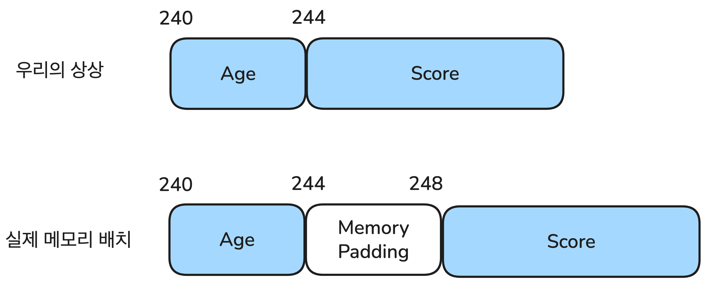
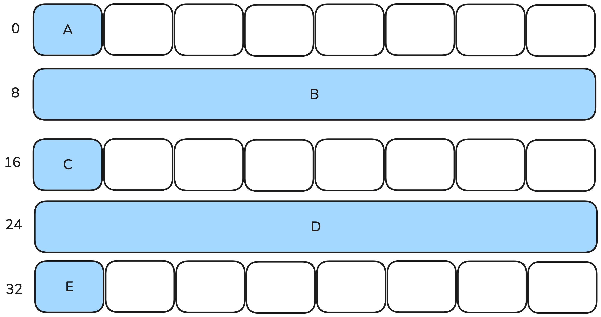
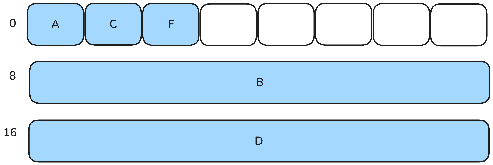

## 요약

> - "Tucker의 Go 언어 프로그래밍"을 책을 읽고 내용을 정리합니다.
> - 1단계 탄탄하게 기초 문법 다지기 내용을 다룹니다.

## 10장. 배열

### 배열

- 배열(array)은 같은 타입의 데이터들로 이루어진 자료구조입니다.
- 배열에 담을 수 있는 최대 요소 개수는 생성할 때 고정되어, 중간에 늘리거나 줄일 수 없습니다.
- 배열은 데이터 타입 앞에 `[]`를 붙여 만듭니다.
- 대괄호 [] 사이에 인덱스를 넣어 배열 요소에 접근할 수 있습니다.
- 배열 선언 시 개수는 항상 상수로 써야 합니다. 변숫값을 배열 개수로 사용할 수 없습니다.

### 배열 변수 선언 및 초기화

```go
// var 변수명 [요소 개수]타입
var num [5]int
```

- 별도로 초깃값을 지정하지 않아 `int` 타입의 기본 값인 0으로 초기화됩니다.

```go
days := [3]string{"monday", "tuesday", "wednesday"}
```

- `string` 타입 요소 3개를 갖는 배열 `days`를 할당합니다. 각 요솟값을 지정한 값으로 초기화합니다.

```go
x := [...]int{10, 20, 30}
```

- `...`을 사용해 배열 요소  개수를 생략할 수 있습니다.
- 이때 배열 요소 개수는 초기화되는 요소 개수와 같습니다

### 배열은 연속된 메모리

- 배열을 선언하면 컴퓨터는 연속된 메모리 공간을 확보합니다. 예를 들어 아래와 같이 선언하면

```go
var a [10]int32
```

- 컴퓨터는 `int32`값 10갸를 저장할 수 있는 연속된 메모리 공간을 찾아 할당합니다. (int32 타입은 4바이트이므로 연속된 40바이트 확보)

- 컴퓨터는 인덱스에 해당하는 요소를 찾아갈 때, 배열의 시작 주소에 `인덱스 x 타입 크기`를 더해서 찾아갑니다.

### 배열 복사

- 대입 연산자를 사용하면 배열 대 배열 복사를 할 수 있습니다.

```go
a := [5]int{1, 2, 3, 4, 5}
b := [5]int{6, 7, 8, 9 ,10}

b = a // b 배열 모든 값에 a 값 복사 (주소 복사가 아님)
```

- Go 언어에서 모든 연산자의 각 항의 타입은 항상 같아야합니다. 대입 연산자도 마찬가지입니다.
- 그래서 `b = a` 코드는 `a`와 `b` 타입이 같지 않으면 에러가 발생합니다.

## 11장. 구조체

### 선언 및 기본 사용

- 구조체는 여러 필드를 묶어서 사용하는 타입입니다.
- 배열이 같은 타입의 값들을 변수 하나로 묶어줬던 것과 달리 구조체는 다른 타입의 값들을 변수 하나로 묶어줍니다.

```go
type 타입명 struct {
      필드명 필드타입
      ...
      필드명 필드타입
}

//예시

type Student struct {
      Name string
      Class int
      No int
      Score float64
}
```

- 타입명의 첫 번째 글자가 대문자이면 패키지 외부로 공개되는 타입입니다.

### 구조체 변수 초기화

```go
type House struct {
      Address string
      Size int
      Price float64
      Type string
}
```

```go
var house House
// Address: "", Size: 0, Price: 0.0, Type: ""
```

- 초깃값을 생략하면 모든 필드가 기본값으로 초기화됩니다.

```go
var house House = House{"서울시 강동구", 28, 9.80, "아파트"}
```

- 모든 필드값을 중괄호 사이에 넣어서 초기화합니다. 모든 필드가 순서대로 초기화됩니다.

### 구조체를 포함하는 구조체

```go
package main

import "fmt"

type User struct {
	Name string
	ID   string
	Age  int
}

type VIPUser struct {
	UserInfo User
	VIPLevel int
	Price    int
}

func main() {
	user := User{"송하나", "hana", 23}
	vip := VIPUser{
		User{"화랑", "hwarang", 40},
		3,
		250,
	}

	fmt.Printf("유저: %s ID: %s 나이: %d\n", user.Name, user.ID, user.Age)
	fmt.Printf("VIP 유저: %s ID: %s 나이: %d VIP 레벨: %d 가격 %d만 원\n",
		vip.UserInfo.Name,
		vip.UserInfo.ID,
		vip.UserInfo.Age,
		vip.VIPLevel,
		vip.Price)
}
/*
유저: 송하나 ID: hana 나이: 23
VIP 유저: 화랑 ID: hwarang 나이: 40 VIP 레벨: 3 가격 250만 원
*/
```

### 포함된 필드 방식

- vip에서 Name이나 ID와 같이 UserInfo 안에 속한 필드를 접근하면 vip.UserInfo.Name과 같이 두 단계를 걸쳐 접근해야 합니다.
- 구조체에서 다른 구조체를 필드로 포함할 때 필드명을 생략하면 .을 한번만 찍어 접근할 수 있습니다.

```go
package main

import "fmt"

type User struct {
	Name string
	ID   string
	Age  int
}

type VIPUser struct {
	User     // 필드명 생략
	VIPLevel int
	Price    int
}

func main() {
	user := User{"송하나", "hana", 23}
	vip := VIPUser{
		User{"화랑", "hwarang", 40},
		3,
		250,
	}

	fmt.Printf("유저: %s ID: %s 나이: %d\n", user.Name, user.ID, user.Age)
	fmt.Printf("VIP 유저: %s ID: %s 나이: %d VIP 레벨: %d 가격 %d만 원\n",
		vip.Name,
		vip.ID,
		vip.Age,
		vip.VIPLevel,
		vip.Price)
}
/*
유저: 송하나 ID: hana 나이: 23
VIP 유저: 화랑 ID: hwarang 나이: 40 VIP 레벨: 3 가격 250만 원
*/
```

### 구조체 크기

- 구조체 변수가 선언되면 컴퓨터는 구조체 필드를 모두 담을 수 있는 메모리 공간을 할당합니다.

```go
type User struct {
      Age int
      Score float64
}

var user User
```

- User 구조체의 user 변수가 선언되면 컴퓨터는 Age와 Score 필드를 연속되게 담을 수 있는 메모리 공간을 찾아 할당합니다.
- int 타입 Age는 8바이트, float64 타입 Score 역시 8바이트이므로 총 16바이트가 필요합니다.
- 즉 구조체 변수 user의 크기는 16바이트가 됩니다.

### 필드 배치 순서에 따른 구조체 크기 변화

```go
package main

import (
	"fmt"
	"unsafe"
)

type User struct {
	Age   int32   // 4byte
	Score float64 // 8byte
}

func main() {
	user := User{23, 72.2}
	fmt.Println(unsafe.Sizeof(user))
}
/*
16
*/
```

- Age를 기존 타입 int에서 int32로 바꿨습니다. int32는 4바이트인데, 구조체의 크기가 12바이트가 아닌 16바이트가 나왔습니다.
- 이는 메모리 정렬(Memory Alignment) 때문에 나온 결과 입니다.

### 메모리 정렬

- 메모리 정렬이란 컴퓨터가 데이터 효과적으로 접근하고자 메모리를 일정 크기 간격으로 정렬하는 것을 말합니다.
- 레지스터는 실제 연산에 사용되는 데이터가 저장되는 곳입니다. 레지스터 크기가 4바이트인 컴퓨터를 32비트 컴퓨터라고 부르고, 레지스터 크기가 8바이트인 컴퓨터를 64비트 컴퓨터라고 부릅니다.
- 레지스터 크기가 8바티으라는 얘기는 한 번 연산에 8바이트 크기를 연산할 수 있다는 얘기입니다.
- 따라서 데이터가 레지스터 크기와 똑같은 크기로 정렬되어 있으면 더욱 효율적으로 데이터를 읽어올 수 있습니다.
- 프로그램 언어에서 데이터를 만들 때 8의 배수인 메모리 주소에 데이터를 할당합니다.



- Ages는 4바이트 공간을 차지하기 때문에 바로 붙여서 Score를 할당하면 Score의 시작주소는 244번지가 됩니다.
- 244는 8의 배수가 아니라서 성능을 손해보기 때문에 User 구조체를 할당할 때 Age와 Score 사이를 4바이트 만큼 띄워서 할당합니다.
- 이렇게 메모리 정렬을 위해서 필드 사이에 공간을 띄우는 것을 메모리 패딩이라고 합니다.

### 메모리 패딩을 고려한 필드 배치 방법

- 메모리 패딩으로 인해 생길 수 있는 문제를 알아보겠습니다.

```go
type User struct {
	A int8 // 1byte
	B int  // 8byte
	C int8 // 1byte
	D int  // 8byte
	E int8 // 1byte
}

func main() {
	user := User{1, 2, 3, 4, 5}
	fmt.Println(unsafe.Sizeof(user))
      // 40byte
}
```



- User 구조체는 1바이트짜리 필드 3개와 8바이트짜리 필드 2개로 구성되어 있기 때문에 19바이트 크기를 차지합니다.
- 하지만 실제 구조체 크기는 메모리 패딩 때문에 40바이트가 됩니다.
- 1바이트 변수 A, C, E 모두에 7바이트씩 패딩됐기 때문입니다.

> 이 같은 메모리 낭비를 줄일 수 있는 방법은 **8바이트보다 작은 필드는 몰아서 배치**하는 것입니다

```go
type User struct {
	A int8 // 1byte
	C int8 // 1byte
	E int8 // 1byte
	B int  // 8byte
	D int  // 8byte

}

func main() {
	user := User{1, 2, 3, 4, 5}
	fmt.Println(unsafe.Sizeof(user))
      // 24
}

```

- 구조체 크기가 24바이트로 줄었습니다.



- 패딩은 "필드 다음에 무조건" 붙는 게 아니라, 다음 필드가 자기 크기의 배수 주소에서 시작해야 하기 때문에 필요할 때만 생깁니다. 이를 정렬(alignment)이라고 합니다. 규칙은 이렇습니다.

- 각 필드는 자신의 크기(정렬 단위)의 배수 주소에 놓여야 합니다. int8은 1의 배수, int(64비트 기준)는 8의 배수입니다.
- 구조체 전체 크기는 가장 큰 필드의 정렬 단위(여기선 8)의 배수가 되도록 끝에 패딩이 붙습니다.

- 정렬 단위는 컴파일 타임에, 컴파일러가 대상 플랫폼(GOOS/GOARCH)의 규칙에 따라 결정합니다. 런타임에 정해지는 것이 아닙니다.

### 프로그래밍에서 구조체의 역할

- 구조체를 이용하면 개발 데이터의 조작/연산보다는 구조체 간의 관계와 상호작용 중심으로 프로그래밍할 수 있습니다.
- 구조체에 메서드, 인터페이스가 추가되면서 객체지향 프로그래밍으로 발전했습니다.

## 12장. 포인터

### 포인터란

- 포인터는 메모리 주소를 값으로 갖는 타입입니다.

```go
var p *int
```
- 포인터 변수는 가리키는 데이터 타입에 *을 붙여서 선언합니다.

```go
var a int
var p *int
p = &a
*p = 10
fmt.Println(a) // 10
```

- 포인터는 메모리 주소를 값으로 갖습니다. 데이터 앞에 &을 붙이면 메모리 주소를 가져올 수 있습니다.
- 포인터 변수 앞에 *를 붙여서 포인터 변수가 가리키고 있는 메모리 주소로 접근할 수 있습니다.
- 포인터의 기본값은 `nil`입니다.

### 포인터는 왜 쓰나?

- 변수 대입이나 함수 인수 전달은 항상 값을 복사하기 때문에 많은 메모리 공간을 사용하는 문제와 큰 메모리 공간을 복사할 때 발생하는 성능 문제를 안고 있습니다.
- 또한 다른 공간으로 복사되기 때문에 변경 사항이 적용되지도 않습니다.

```go
package main

import "fmt"

type Data struct {
	value int
	data  [200]int
}

func ChangeDataFromValue(arg Data) {
	arg.value = 999
	arg.data[100] = 999
}

func ChangeDataFromRef(arg *Data) {
	arg.value = 999
	arg.data[100] = 999
}

func main() {
	var data Data

	ChangeDataFromValue(data)
	fmt.Printf("value = %d\n", data.value)
	fmt.Printf("data[100] = %d\n", data.data[100])

	ChangeDataFromRef(&data)
	fmt.Printf("value = %d\n", data.value)
	fmt.Printf("data[100] = %d\n", data.data[100])
}
/*
value = 0
data[100] = 0
value = 999
data[100] = 999
*/
```

- `ChangeDataFromValue()` 의 문제점
      - 함수 호출 시 data 변숫값이 모두 복사되기 때문에 구조체 크기만큼 복사됩니다.
      - Data 구조체는 int 타입 value와 크기가 200인 int 타입 배열 data로 구성되어 있어 총 1608바이트입니다.
      - 따라서 함수 호출 때마다 1608바이트가 복사됩니다.

- 해결 방법 `ChangeDataFromRef()`
      - 함수 매개변수로 Data 구조체의 포인터를 받는 것으로 변경했습니다.
      - 이제 data 변수값이 아니라 data의 메모리 주소를 인수로 전달합니다.
      - 메모리 주소는 8바이트 숫자값이기때문에 1608바이트의 구조체가 전부 복사되는 게 아니라 8바이트만 복사됩니다.
      - arg 포인터 변수가 가리키는 구조체의 값을 변경합니다.

### 인스턴스

- 인스턴스란 메모리에 할당된 데이터의 실체를 말합니다.
- 다음 코드는 Data 타입값을 저장할 수 있는 메모리 공간을 할당합니다.

```go
var data Data
```

- 이렇게 할당된 메모리 공간의 실체를 인스턴스라고 부릅니다.

```go
var data Data
var p *Data = &data
```

- Data 타입 포인터 변수 p를 선언하고 data의 주소를 대입했습니다.
- 이때 포인터 변수 p는 data를 가리킨다고 말합니다.

```go
var p *Data = &Data{}
```

- 위와 같이 인스턴스를 생성함과 동시에 포인터 변수에 초기값으로 대입할 수도 있습니다.

```go
p1 := &DataP{}
var p2 = new(Data)
```

- `new()` 내장함수를 사용해서 포인터 변수에 주소를 초기화할 수 있습니다.

### 인스턴스는 언제 사라지나

- Go 언어는 가비지 컬렉터라는 메모리 청소부 기능을 제공합니다
- 가비지 컬렉터가 일정 간격으로 메모리에서 쓸모없어진 데이터를 청소합니다.
- 아무도 찾지 않는 데이터는 쓸모없는 데이터라고 판단합니다.

### 스택 메모리와 힙 메모리

- 대부분의 프로그래밍 언어는 메모리를 할당할 때 스택 메모리 영역 또는 힙 메모리 영역을 사용합니다.
- 이론상 스택 메모리 영역이 힙 메모리 영역보다 효율적이기 때문에 스택 메모리 영역에서 메모리를 할당하는 게 더 좋지만, 스택 메모리는 함수 내부에서만 사용 가능한 영역입니다.
- 그래서 함수 외부로 공개되는 메모리 공간은 힙 메모리 영역에서 할당합니다.
- 자바에서는 클래스 타입을 힙에, 기본 타입을 스택에 할당합니다.
- Go 언어에서는 탈출 검사(`escape analysis`)를 해서 어느 메모리에 할당할 지 결정합니다.
- Go 언어에서는 탈출 검사를 통해서 변수의 인스턴스가 함수 외부로 공개되는 것을 분석해내서 변수를 스택 메모리가 아닌 힙 메모리에 할당하게 됩니다.
- 즉 Go 언어는 어떤 타입이나 메모리 할당 함수에 의해서 스택 메모리를 사용할 지 힙 메모리를 사용할 지를 결정하지 않습니다.
- 메모리 공간이 함수 외부로 공개되는 지 여부를 자동으로 검사해서 스택 메모리에 할당할 지 힙 메모리에 할당할지 결정합니다.
- 또 Go 언어에서 스택 메모리는 계속 증가도니는 동적 메모리 풀입니다. 일정한 크기를 갖는 C/C++ 언어와 비교해 메모리 효율성이 높고, 재귀 호출 때문에 스택 메모리가 고갈되는 문제도 발생하지 않습니다.

## 13장. 문자열
## 14장. 패키지
